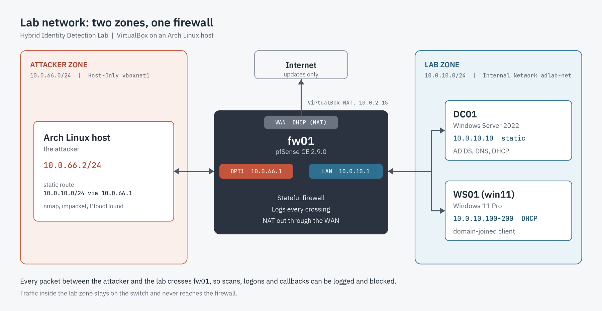

## Requirement

Traffic from the attacker to the Active Directory lab must pass through a firewall that logs it. Network detections depend on that log.

## Principle

A network firewall at a subnet boundary inspects traffic routed between networks. Hosts on the same subnet resolve each other's MAC addresses with ARP and exchange traffic directly through the switch, bypassing the gateway. If the attacker and the domain controller shared a subnet, a scan between them might never reach the firewall, and it would not appear in the firewall log.

The attacker therefore sits on its own subnet, and the firewall routes traffic between the two.

A host firewall, such as Windows Defender Firewall on the domain controller, is a separate logging point. It sees traffic that reaches that machine, whatever the subnet layout.

## Design

| Zone | VirtualBox mode | Subnet | Members |
|---|---|---|---|
| Attacker | Host-Only (`vboxnet1`) | `10.0.66.0/24` | Arch host, `10.0.66.2` |
| Lab | Internal Network (`adlab-net`) | `10.0.10.0/24` | DC01, WS01 |
| Internet | NAT | Assigned by VirtualBox | pfSense WAN only |

| pfSense interface | Address | Role |
|---|---|---|
| WAN | DHCP (NAT) | Internet access for updates |
| LAN | `10.0.10.1` | Gateway for the lab zone |
| OPT1 | `10.0.66.1` | Gateway for the attacker zone, and the point where attacker traffic is logged |

{: width="1800" height="930" }
_Two zones with pfSense between them_

DC01 and WS01 share the lab subnet, so traffic between them does not pass through pfSense. The firewall sees traffic between the zones and traffic to the internet. Servers and clients can be split later by adding an interface.

## VirtualBox network modes

* **Attacker zone, Host-Only:** gives the Arch host an adapter on an isolated virtual network, so the attacker machine sits on the same wire as the firewall.
* **Lab zone, Internal Network:** isolated from the host and from the internet. The only way out is through pfSense.
* **WAN, NAT:** internet access for pfSense only.

## Addressing and services

**DNS and DHCP run on the domain controller.** Active Directory finds domain controllers through DNS, so clients must use DC01 as their DNS server. DHCP on DC01 hands out the gateway and the DNS server together, so DHCP on pfSense is turned off to avoid two servers answering.

**The host needs a route to the lab.** The host is directly connected to `10.0.66.0/24` and has no route to `10.0.10.0/24`. Without one, lab-bound traffic goes to the default gateway and bypasses pfSense:

```bash
sudo ip route add 10.0.10.0/24 via 10.0.66.1
```

This route is lost at reboot. Make it permanent with a systemd service that re-applies it with `ip route replace`.

## Safety controls

* No bridged adapters, so nothing reaches the real network.
* The Arch host does not forward lab traffic. Docker enables IP forwarding, so the IPv4 `FORWARD` policy is set to `DROP`, and no rule accepts traffic from the lab interface. IPv6 forwarding is off through `net.ipv6.conf.all.forwarding=0`.

---

Next: [Installing pfSense as the Gateway for My Active Directory Lab](/posts/installing-pfsense-as-the-lab-gateway/)
