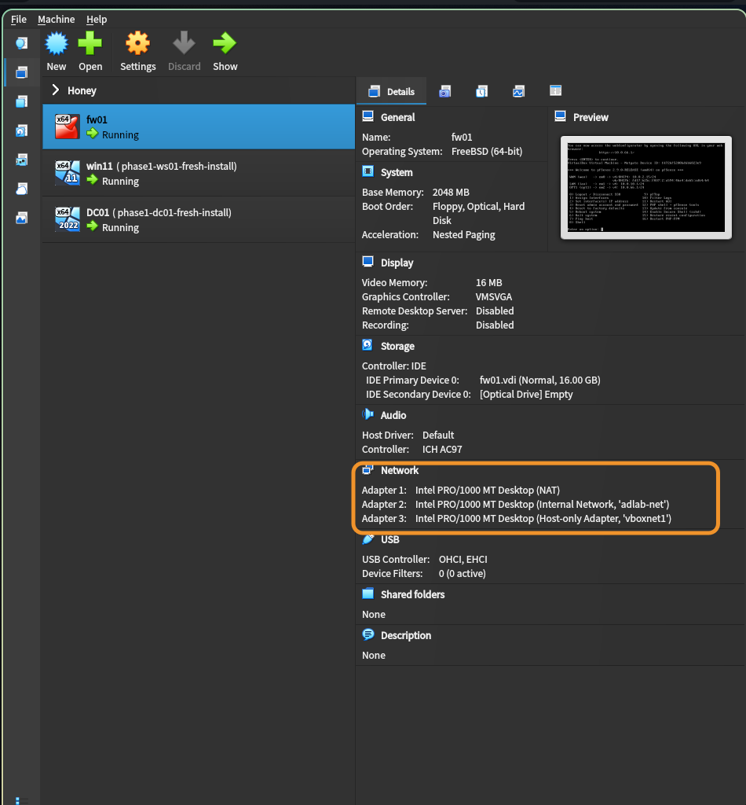
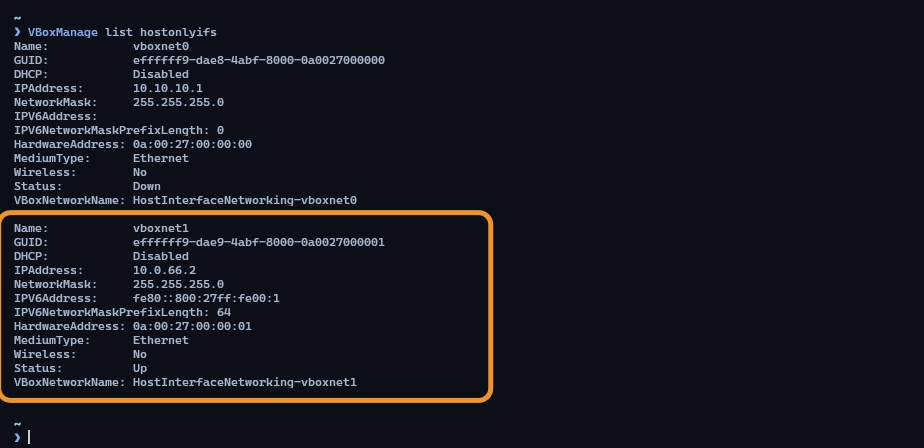
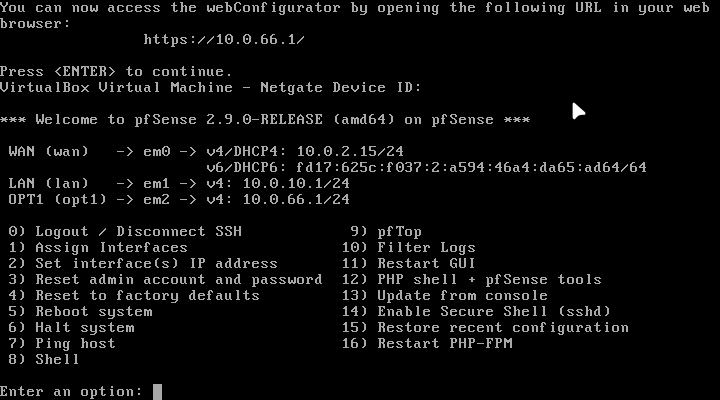
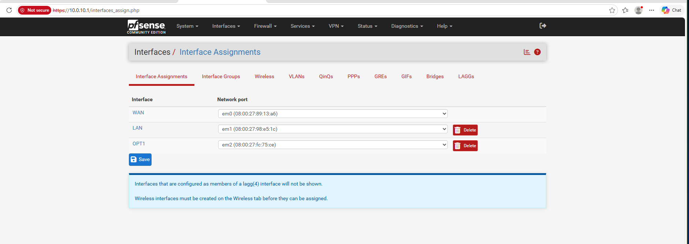
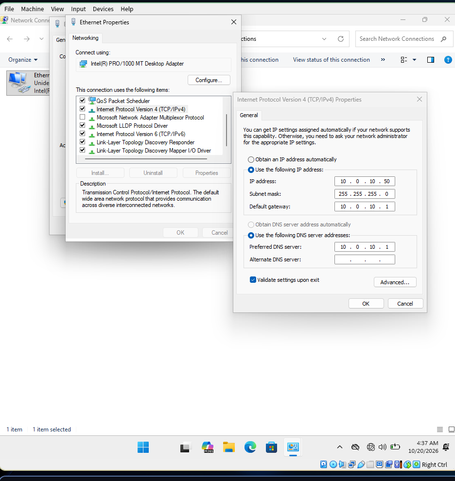
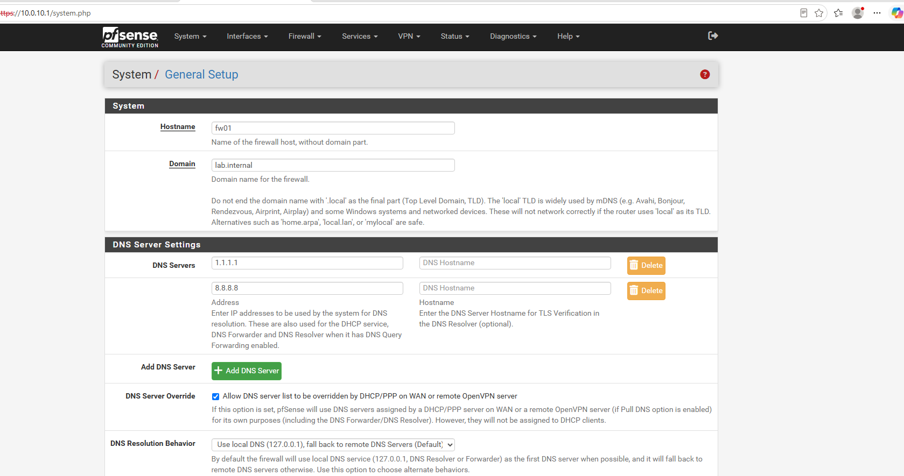
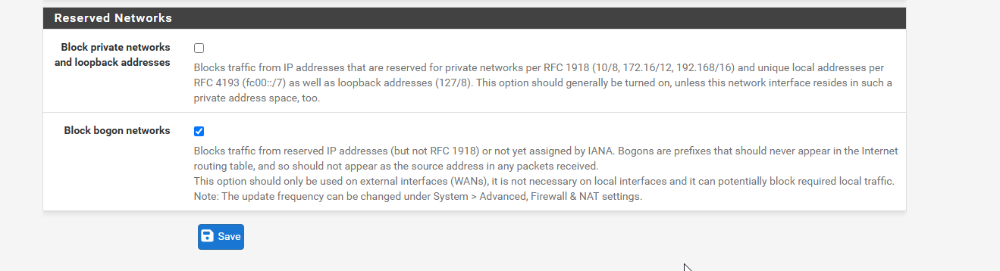
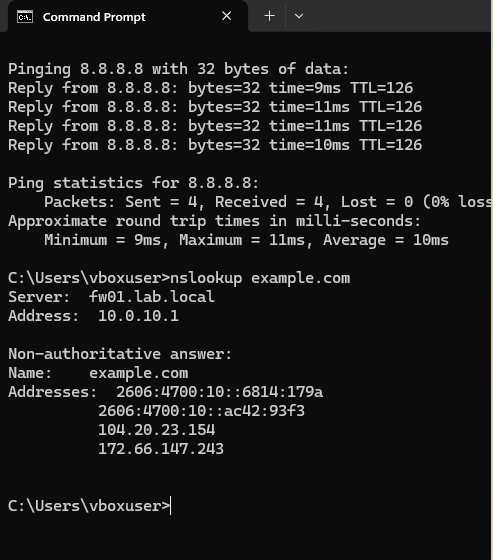
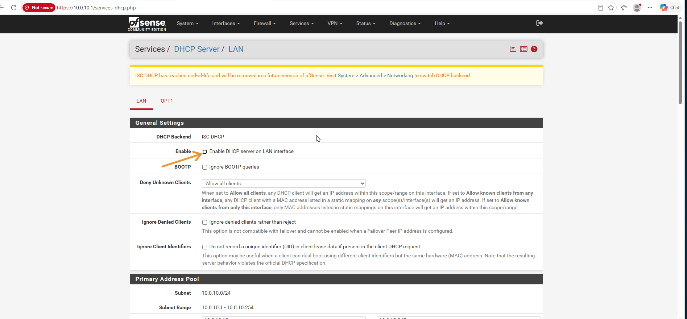
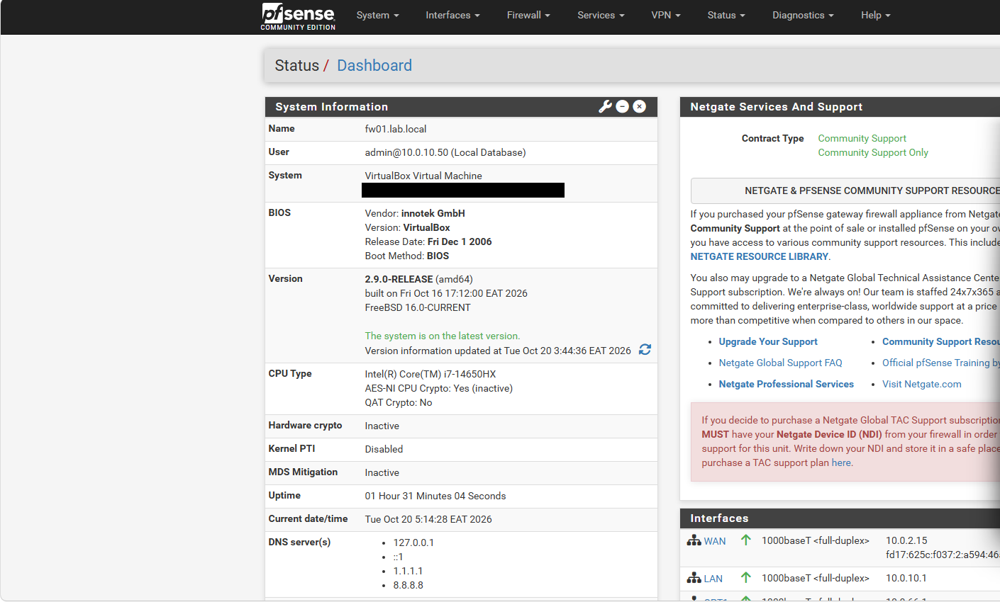

## Objective

Install pfSense as `fw01`, give it an interface in each network zone, and verify that a client on the lab network reaches the internet through it.

## Environment

* **Host:** Arch Linux, 16 GB RAM, VirtualBox 7.2
* **Firewall VM:** `fw01`, pfSense CE 2.9.0, 2 GB RAM and 16 GB disk during installation
* **Client VM:** `win11` on the internal network `adlab-net`

The VM has three adapters. pfSense names the interfaces in the order VirtualBox presents them:

| Adapter | VirtualBox mode | pfSense name | Role |
|---|---|---|---|
| 1 | NAT | `em0` | WAN |
| 2 | Internal Network `adlab-net` | `em1` | LAN |
| 3 | Host-Only `vboxnet1` | `em2` | OPT1 (attacker side) |

{: width="950" height="1024" }
_The three adapters of `fw01`_

---

## Prepare the host

The Arch host is the attacker, so it needs an interface on the same virtual network as the firewall. VirtualBox on Linux only accepts host-only ranges listed in `/etc/vbox/networks.conf`. Add the attacker range and keep the existing lines:

```bash
echo '* 10.0.66.0/24' | sudo tee -a /etc/vbox/networks.conf
VBoxManage hostonlyif create
VBoxManage hostonlyif ipconfig vboxnet1 --ip 10.0.66.2 --netmask 255.255.255.0
```

{: width="520" height="405" }
_`vboxnet1` with DHCP disabled_

---

## Install pfSense

Use Netgate's installer image, which downloads pfSense during installation. Choose **pfSense CE**, ZFS with a single-disk stripe, and the 2.9.0 stable release.

On the installer's LAN screen, replace the default `192.168.1.1/24` with `10.0.10.1/24` and turn the DHCP server off, because the domain controller provides DHCP.

If the installer stops with a timeout while downloading packages, run the installation again.

After the installation, power off the VM and remove the installer ISO from the virtual optical drive before the first boot.

---

## Assign the interfaces

The installer sets up WAN and LAN only. After the first boot, the console shows WAN on DHCP (`10.0.2.15`, VirtualBox's NAT address) and LAN at `10.0.10.1/24`. OPT1 has to be added from the console:

1. Option **1** (Assign Interfaces): assign `em2` to OPT1.
2. Option **2** (Set interface IP address): configure OPT1.

| Setting | Value | Reason |
|---|---|---|
| IPv4 mode | static | A gateway needs a fixed address. |
| Address | `10.0.66.1/24` | Matches the attacker subnet. |
| Upstream gateway | none | Only WAN leads to the internet. |
| DHCP on OPT1 | off | The Arch host has a static address. |

{: width="720" height="400" }
_WAN, LAN and OPT1 configured_

Before you assign interfaces, match each pfSense name to its adapter by MAC address. The web interface lists them:

{: width="1882" height="668"}
_`em0` WAN, `em1` LAN, `em2` OPT1_

---

## Reach the web interface

pfSense blocks everything that arrives on a new interface until a rule allows it, so the web interface is not reachable from the attacker side yet. The LAN side has a built-in rule, so use the Windows 11 client.

Give the client a temporary static address on `adlab-net`: `10.0.10.50/24`, gateway `10.0.10.1`, DNS `10.0.10.1`. Click OK to save the settings before you open `https://10.0.10.1`.

{: width="936" height="990" }
_Temporary static address on the Windows 11 client_

Log in with the default credentials and change the password in the setup wizard. Set:

* **Hostname:** `fw01`
* **Domain:** `lab.internal`. Avoid `.local`: pfSense warns that the suffix is used for mDNS, and Microsoft advises against it for Active Directory.
* **Timezone:** `Africa/Nairobi`
* **WAN type:** DHCP

{: width="1679" height="885" }
_General Setup_

On the WAN interface, untick **Block private networks**, because the WAN sits behind VirtualBox NAT and its addresses are private. Keep **Block bogon networks** ticked.

{: width="1319" height="358" }
_Private networks allowed, bogon networks blocked_

---

## Verify

From the Windows 11 client:

```
ping 8.8.8.8
nslookup example.com
```

{: width="493" height="560" }
_Replies from `8.8.8.8`, and DNS answered by `fw01`_

* The ping replies have **TTL 126**. Windows starts at 128 and each router subtracts one, so the packets crossed two routers: pfSense and VirtualBox's NAT.
* `nslookup` shows `fw01` at `10.0.10.1` answering, so pfSense's DNS resolver serves the lab.

DHCP must be off on pfSense's LAN, because two DHCP servers on one network hand out conflicting settings:

{: width="1895" height="880" }
_"Enable DHCP server on LAN interface" is unticked_

{: width="1410" height="850" }
_Version 2.9.0, all three interfaces up_

---

## Notes

* **Remove the installer ISO before the first reboot.** Otherwise the VM boots into the installer again.
* **The red letters in the installer menus are hotkeys.** Typing one changes the value. Read the screen before you type.
* **Test one layer at a time:** address, then ping, then port. A fault at the first layer makes every later test fail.

---

Next: [Sending attack traffic through the firewall](/posts/sending-attack-traffic-through-the-firewall/)
