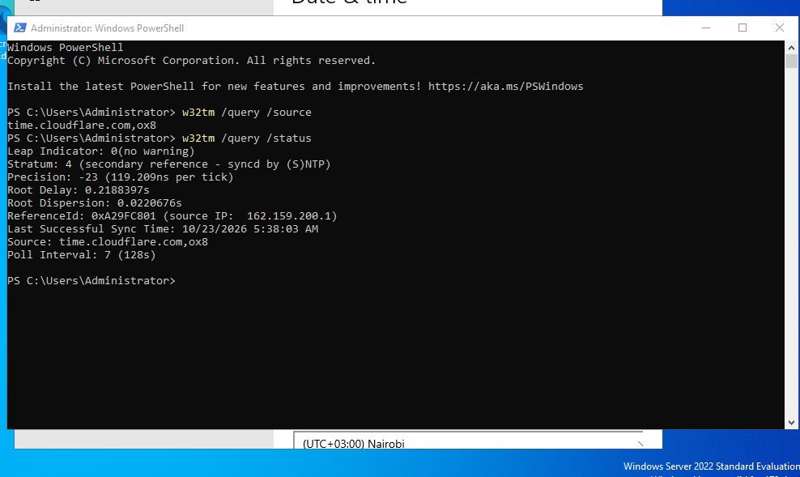
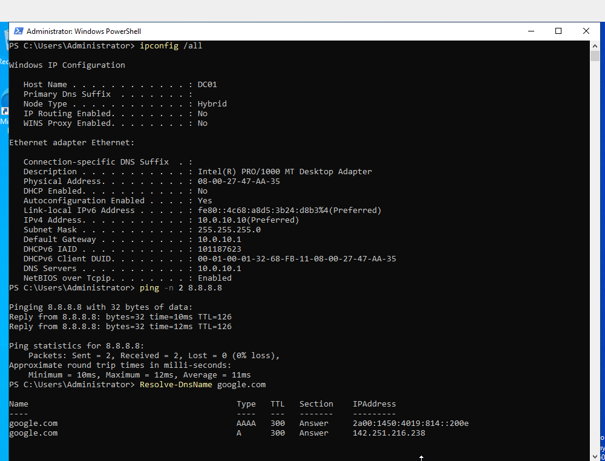
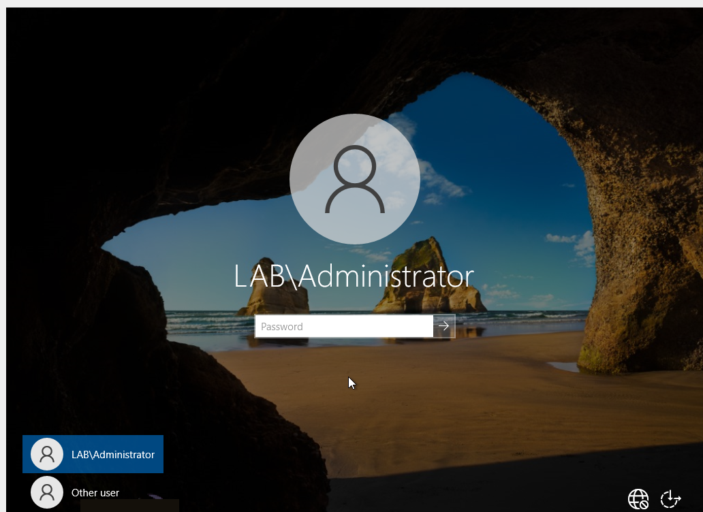
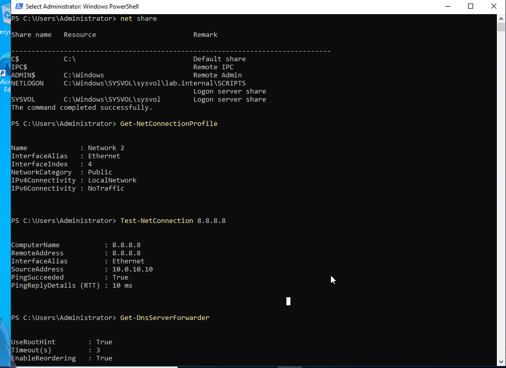
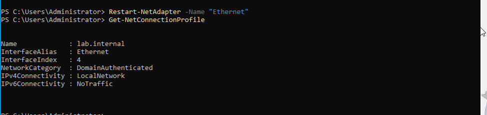
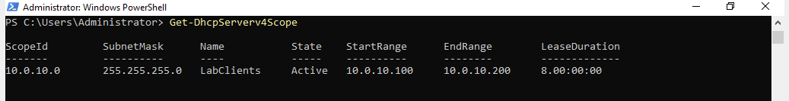
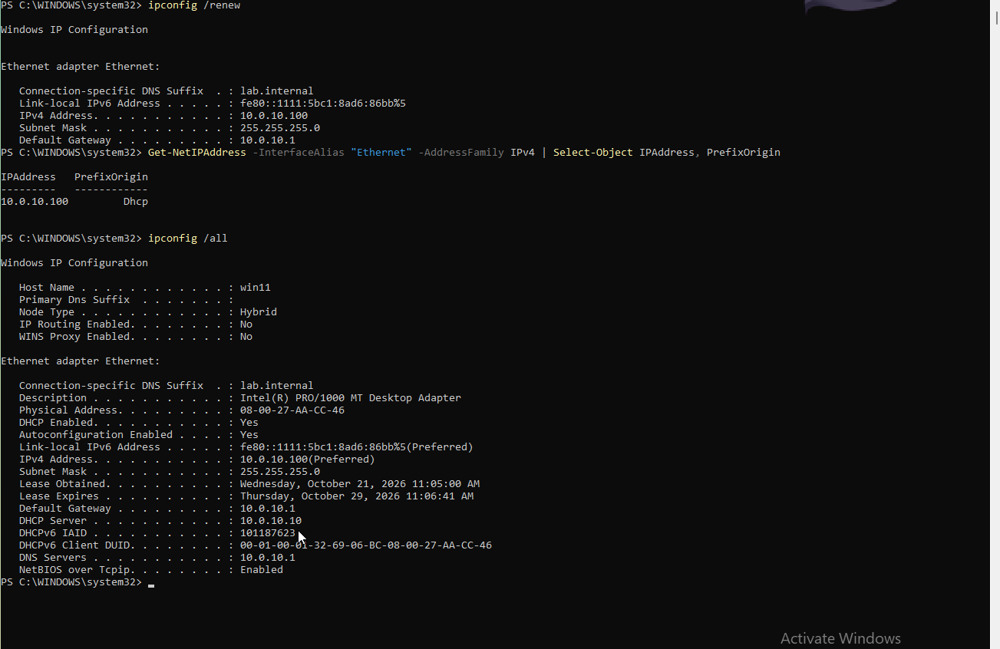
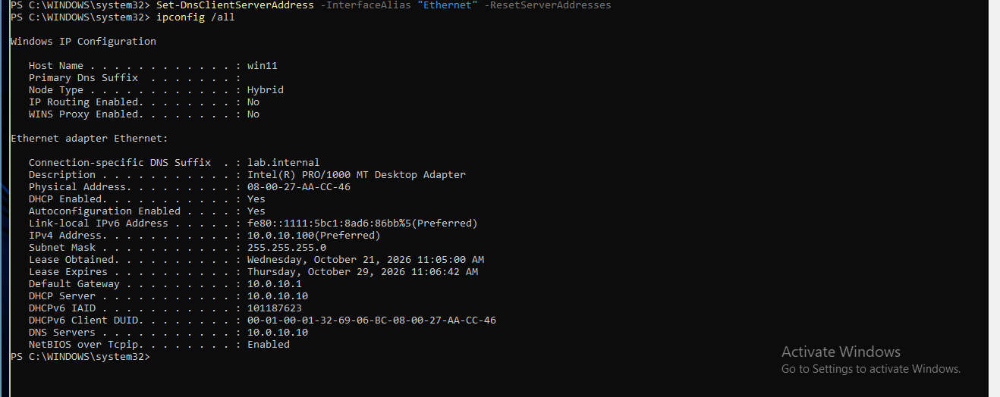

## Objective

Build the `lab.internal` domain on a Windows Server domain controller with DNS and DHCP, and confirm that the Windows 11 client receives its lease from it.

## Environment

* **DC01:** Windows Server 2022 evaluation, 3 GB RAM, 2 CPUs, on the internal network `adlab-net`
* **win11:** Windows 11 Pro on the same network. Windows 11 Home cannot join a domain.
* **fw01:** pfSense, the gateway at `10.0.10.1`

With all three VMs running, a 16 GB host reaches about 92% memory use. DC01 runs at 3 GB and `fw01` at about 1.2 GB.

Take a snapshot before each risky step: `phase1-dc01-fresh-install`, `phase1-dc01-before-ad` and `phase1-dc01-ad-installed`.

---

## Set the time

Kerberos rejects logins when two clocks differ by more than five minutes, and every domain member takes its time from the domain controller. Set the time zone and the time source before you promote DC01:

```powershell
Set-TimeZone -Id "E. Africa Standard Time"
w32tm /config /manualpeerlist:"time.cloudflare.com,0x8 pool.ntp.org,0x8" /syncfromflags:manual /reliable:yes /update
w32tm /query /status
```

The source must be an external server. On the clients, `w32tm /query /source` returns `DC01.lab.internal`.

DC01 once showed the wrong date, time and time zone, and the Settings app locked the time controls. Setting both with commands worked.

{: width="988" height="589" }
_DC01 synchronises from `time.cloudflare.com`_

---

## Fixed address and name

A domain controller needs an address that never changes, because every other machine is told where to find it. Use `10.0.10.10/24` with the pfSense gateway. Point DNS at pfSense for now, because DC01's own DNS does not exist until the domain is created. Rename the server to `DC01` and restart before you create the domain, because renaming a domain controller afterwards is difficult.

```powershell
New-NetIPAddress -InterfaceAlias "Ethernet" -IPAddress 10.0.10.10 -PrefixLength 24 -DefaultGateway 10.0.10.1
Set-DnsClientServerAddress -InterfaceAlias "Ethernet" -ServerAddresses 10.0.10.1
```

{: width="1000" height="762" }
_Host name DC01, the fixed address, and a working ping and DNS lookup through pfSense_

When Windows asks whether to make the PC discoverable on the network, answer **No**. That sets the stricter Public profile. A domain controller is found through DNS and Active Directory, not through network discovery.

---

## Install AD DS and create the domain

```powershell
Install-WindowsFeature AD-Domain-Services -IncludeManagementTools
Install-ADDSForest -DomainName "lab.internal" -DomainNetbiosName "LAB" -InstallDns
```

| Part | Meaning |
|---|---|
| `Install-ADDSForest` | Creates a new forest, the top-level container of an AD environment, with its first domain and domain controller. |
| `-DomainName "lab.internal"` | The domain name. It is difficult to change later. |
| `-DomainNetbiosName "LAB"` | The short name used in logins, such as `LAB\Administrator`. |
| `-InstallDns` | Installs DNS on the server. Active Directory finds everything through DNS. |

The command asks for a Directory Services Restore Mode password, an emergency recovery login. Store it safely, because the directory cannot be recovered without it.

After the restart, the login screen offers `LAB\Administrator`.

{: width="1032" height="752" }
_The domain login screen_

---

## Check the domain

```powershell
dcdiag /q
nslookup lab.internal
net share
Get-DnsServerForwarder
```

* `nslookup lab.internal` returns `10.0.10.10`, so DC01's DNS answers for the domain.
* `net share` lists `NETLOGON` and `SYSVOL`. Clients use them for logon scripts and Group Policy.
* The DNS forwarder is `10.0.10.1`, so names outside the domain resolve through pfSense.
* `dcdiag /q` prints only failures. On this lab's DC01 it reported one failed test, `DFSREvent`. It is covered under the open items in the [last post](/posts/turning-on-the-windows-firewall-without-breaking-the-domain/) of the series.

{: width="1000" height="728" }
_`SYSVOL` and `NETLOGON` are shared_

### Network profile

After promotion, `Get-NetConnectionProfile` can report the network as **Public**. Restart the network adapter so the profile refreshes to **DomainAuthenticated**:

```powershell
Restart-NetAdapter -Name "Ethernet"
Get-NetConnectionProfile
```

Check the profile after each restart. Group Policy firewall rules apply per profile, so the profile decides which rules are active.

{: width="975" height="230" }
_The network is named `lab.internal` and categorised as DomainAuthenticated_

---

## DHCP

pfSense's DHCP server is off, so the domain controller hands out addresses:

```powershell
Install-WindowsFeature DHCP -IncludeManagementTools
Add-DhcpServerInDC -DnsName "DC01.lab.internal" -IPAddress 10.0.10.10
Add-DhcpServerv4Scope -Name "LabClients" -StartRange 10.0.10.100 -EndRange 10.0.10.200 -SubnetMask 255.255.255.0 -State Active
Set-DhcpServerv4OptionValue -ScopeId 10.0.10.0 -Router 10.0.10.1 -DnsServer 10.0.10.10 -DnsDomain "lab.internal"
Get-DhcpServerv4Scope
```

| Command | Purpose |
|---|---|
| `Add-DhcpServerInDC` | Authorises the server in Active Directory. An unauthorised DHCP server does not issue leases on a domain, which protects against rogue servers. |
| `Add-DhcpServerv4Scope` | The pool `10.0.10.100` to `10.0.10.200`. The fixed addresses sit outside it. |
| `Set-DhcpServerv4OptionValue` | What each client receives: gateway `10.0.10.1`, DNS `10.0.10.10`, domain `lab.internal`. |

{: width="1037" height="134" }
_The scope is active_

---

## First lease

Switch the Windows 11 client from its fixed address to automatic, then read the result:

{: width="1303" height="846" }
_The lease from DC01_

* The address is `10.0.10.100`, and `PrefixOrigin` says `Dhcp`.
* The DHCP server is `10.0.10.10`, so DC01 issued the lease, not pfSense.
* The gateway is `10.0.10.1`, and the lease runs for 8 days.

Check the DNS server line. It must be `10.0.10.10`, DC01, or the client cannot find the domain. A DNS value left over from the static configuration overrides the one from DHCP. Reset it:

```powershell
Set-DnsClientServerAddress -InterfaceAlias "Ethernet" -ResetServerAddresses
ipconfig /all
```

{: width="1318" height="524" }
_After the reset, the client's DNS server is DC01_

---

## Notes

* **Set the time zone and time source before promotion.** Every domain member takes its time from the domain controller.
* **Rename the server before you create the domain.**
* **Read the DNS line right after the client switches to automatic addressing.** A leftover static DNS value is visible in the first `ipconfig /all`.

---

Next: [Joining a Windows 11 Client to the Domain](/posts/joining-a-windows-client-to-the-domain/)
