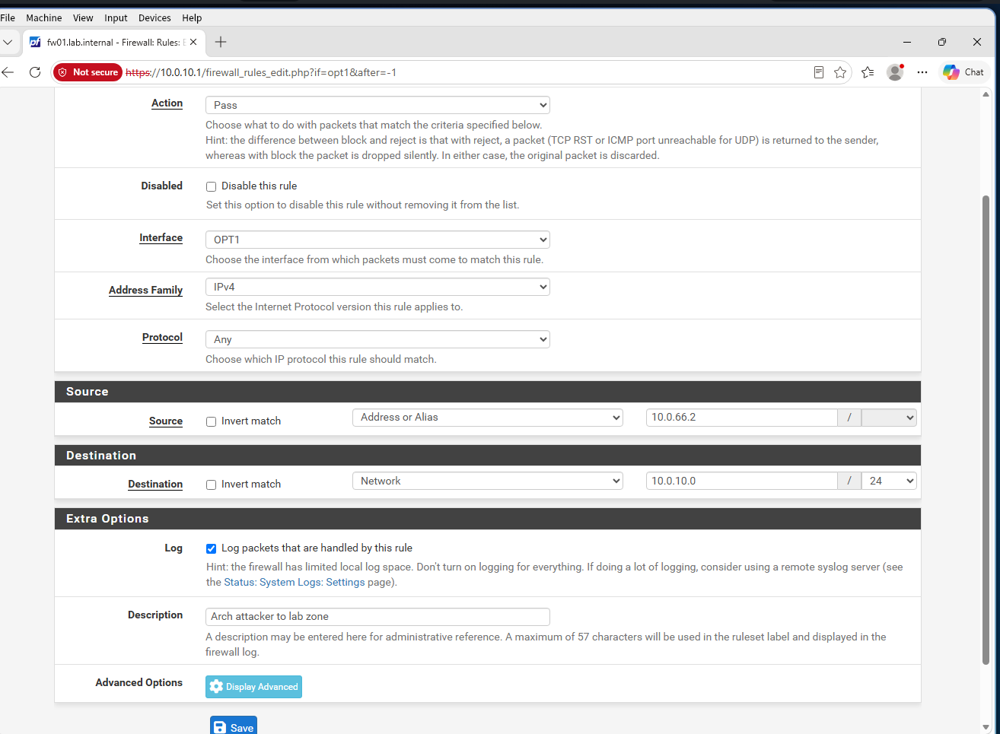
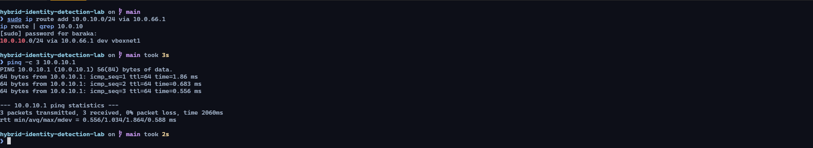
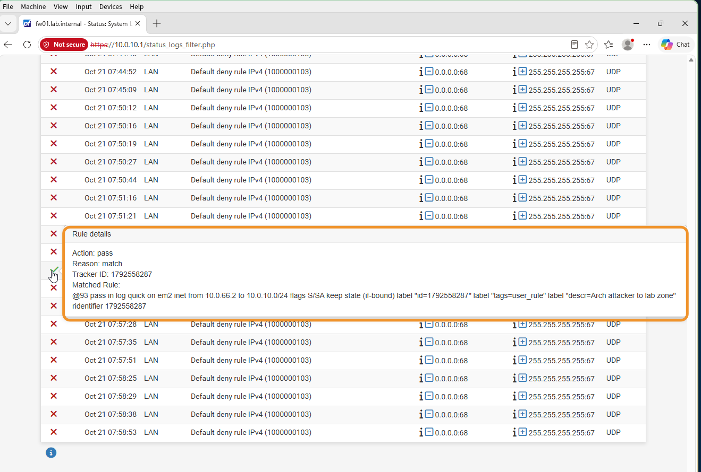

## Objective

Make the Arch host reach the lab zone only through pfSense, and confirm that the firewall logs the traffic.

Two things block the path:

1. **pfSense drops everything that arrives on a new interface.** The LAN has a built-in allow rule. OPT1, the attacker side, has none.
2. **The host has no route to the lab.** It is connected to `10.0.66.0/24`, so lab-bound traffic goes to the default gateway and bypasses pfSense.

---

## Firewall rule

Add a pass rule under **Firewall → Rules → OPT1**:

| Field | Value | Reason |
|---|---|---|
| Action | Pass | |
| Interface | OPT1 | Rules apply to traffic entering an interface. |
| Protocol | Any | Open for now. Narrow it once the traffic to study is known. |
| Source | `10.0.66.2` | The attacker host only, not the whole subnet. |
| Destination | `10.0.10.0/24` | The lab zone only. The attacker gets no internet access through this rule. |
| Log | Enabled | The firewall records what matches the rule. |
| Description | `Arch attacker to lab zone` | |

{: width="1314" height="965" }
_The rule with logging enabled_

---

## Host route

Send lab-bound traffic to pfSense's attacker-side address:

```bash
sudo ip route add 10.0.10.0/24 via 10.0.66.1
ip route | grep 10.0.10
```

The output must show `10.0.10.0/24 via 10.0.66.1 dev vboxnet1`. To see which gateway and interface the host will use for a destination, run `ip route get 10.0.10.1`.

A route added with `ip route add` is lost at reboot. Keep it in place with a systemd service, `/etc/systemd/system/lab-route.service`, that re-applies it every 20 seconds:

```ini
[Unit]
Description=Keep the route to the lab network (10.0.10.0/24 via fw01) in place
After=network.target

[Service]
Type=simple
ExecStart=/bin/sh -c 'while true; do /usr/bin/ip route replace 10.0.10.0/24 via 10.0.66.1 dev vboxnet1 2>/dev/null; sleep 20; done'
Restart=on-failure

[Install]
WantedBy=multi-user.target
```

```bash
sudo systemctl enable --now lab-route.service
```

To test it, delete the route, wait 25 seconds, and list the routes again:

```bash
sudo ip route del 10.0.10.0/24 via 10.0.66.1
sleep 25
ip route | grep 10.0.10
```

The route must be back.

---

## Verify that the traffic crosses the firewall

```bash
ping -c 3 10.0.10.1
```

{: width="1581" height="288" }
_Three pings answered_

A reply alone does not show the path. Check the firewall log under **Status → System Logs → Firewall**. The entry for the ping matches the rule:

```
pass in log quick on em2 inet from 10.0.66.2 to 10.0.10.0/24 ... descr=Arch attacker to lab zone
```

{: width="1319" height="890" }
_A packet from `10.0.66.2` enters on `em2` (OPT1) and passes_

`em2` is the attacker-side interface, so attacker traffic is logged where it enters the firewall.

The ping replies have **TTL 64**, pfSense's own starting value. No router subtracted from it, because `10.0.10.1` is the firewall's own address. This test reaches only the firewall's lab-side address. The domain controller and the client are tested after the domain is built.

---

## Notes

* **Check the route before you test the connection.** `ip route get` shows what the host will use.
* **Test the persistence.** Delete the route and confirm that the service restores it.

---

Next: [Building the Domain Controller with AD DS, DNS and DHCP](/posts/building-the-domain-controller/)
