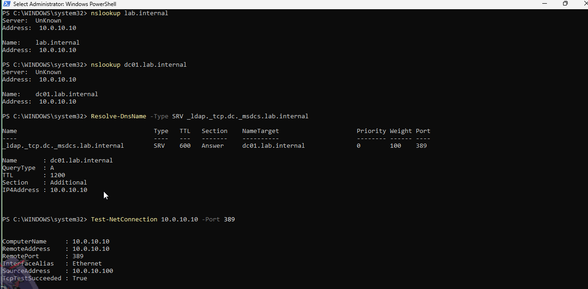
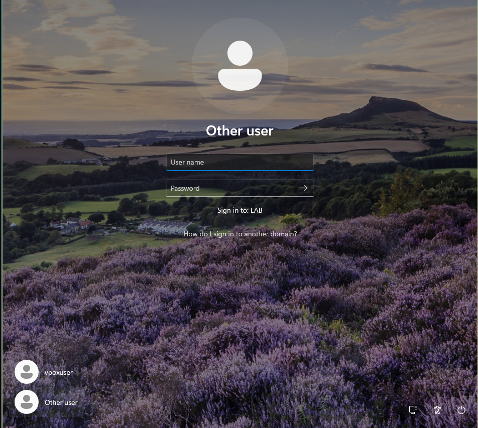
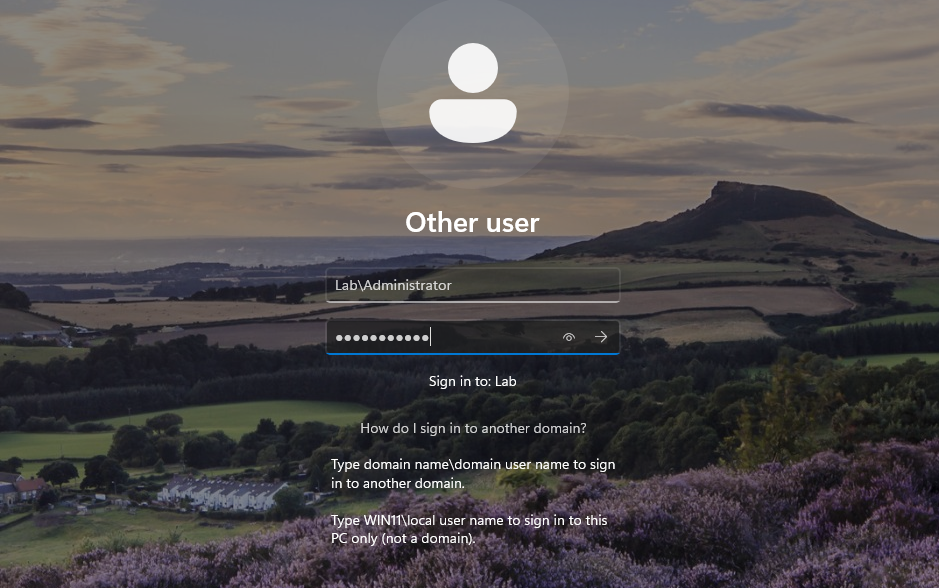
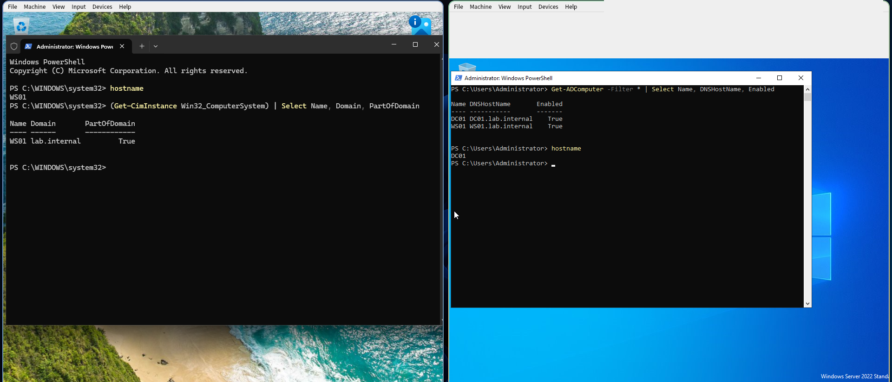

## Objective

Join the Windows 11 client to `lab.internal`, rename it to `WS01`, and confirm the join from both machines.

## Environment

* **DC01:** Windows Server 2022, `10.0.10.10`, domain controller, DNS and DHCP
* **win11:** Windows 11 Pro, `10.0.10.100`, to be renamed `WS01`
* **fw01:** pfSense, `10.0.10.1`, the gateway

---

## Check that the client can find the domain

A domain join needs more than a working network. The client must find a domain controller, and it does that through DNS. Run these checks on the client before you change anything:

```powershell
nslookup lab.internal
nslookup dc01.lab.internal
Resolve-DnsName -Type SRV _ldap._tcp.dc._msdcs.lab.internal
Test-NetConnection 10.0.10.10 -Port 389
```

| Check | What it proves |
|---|---|
| `nslookup lab.internal` and `dc01.lab.internal` | DC01's DNS answers for the domain and for the server. |
| The SRV query | The record Windows uses to locate a domain controller. If it is missing, the join fails with "domain could not be contacted". |
| Port 389 | LDAP, the directory service the client talks to, is reachable. |

{: width="1274" height="628" }
_Both names resolve to `10.0.10.10`, the SRV record names `dc01.lab.internal` on port 389, and the LDAP test succeeds_

`nslookup` prints `Server: UnKnown` because it first does a reverse lookup of the DNS server's own address, and DC01 has no reverse lookup zone for `10.0.10.x`. The answers are not affected.

Take a snapshot before the join: `phase1-ws01-before-join`.

---

## Join and rename

Join the domain and rename the computer as two separate steps. `Get-Credential` opens a box for the domain administrator's password, so it does not appear in the command or the shell history.

```powershell
Add-Computer -DomainName "lab.internal" -Credential (Get-Credential LAB\Administrator) -Restart
```

After the restart, rename the computer:

```powershell
Rename-Computer -NewName "WS01" -DomainCredential LAB\Administrator -Restart
```

On a domain-joined machine, `Rename-Computer` renames the Active Directory object as well, so the directory and DNS stay consistent.

---

## Sign in

After the restart, the login screen offers the local account and **Other user**. Use **Other user** to type an account the machine hasn't seen yet. The line **Sign in to: LAB** confirms the join.

{: width="952" height="853" }
_"Sign in to: LAB" means the join worked_

Type the account as `LAB\Administrator`, with a backslash. Capitals don't matter, and the UPN form `administrator@lab.internal` also works.

{: width="939" height="588" }
_Domain name, backslash, user name_

The name before the backslash decides which account store checks the password:

| You type | Who checks the password |
|---|---|
| `LAB\Administrator` | DC01, through Active Directory. |
| `WS01\vboxuser` | This PC alone, in its local account database. |

The two sets of accounts are separate. A local `Administrator` and the domain's `LAB\Administrator` can exist at the same time, with different passwords and rights. A user name typed without a domain goes to the local account.

---

## Verify from both sides

On WS01:

```powershell
hostname
(Get-CimInstance Win32_ComputerSystem) | Select Name, Domain, PartOfDomain
```

On DC01:

```powershell
Get-ADComputer -Filter * | Select Name, DNSHostName, Enabled
```

{: width="1920" height="825" }
_Left: WS01 is part of `lab.internal`. Right: DC01 lists DC01 and WS01 as computers_

* WS01 reports `WS01`, `lab.internal` and `PartOfDomain True`.
* DC01 lists `DC01` and `WS01`, both enabled, and no `WIN11`. The rename updated the directory object.

Take a snapshot on each machine: `phase1-ws01-domain-joined` and `phase1-dc01-ws01-joined`.

---

## Notes

* **Join and rename in separate steps.** A combined command can join the machine and still fail the rename, which leaves it half-finished.
* **Type the domain before the user name every time**, even when the screen offers a default.

---

Next: [Creating, Breaking and Fixing Active Directory Objects by Hand](/posts/creating-breaking-and-fixing-ad-objects/)
