## Objective

Run the full life of one test account by hand (create, edit, move, delete, disable, enable, restore) and read the Windows event each action writes. Detections use these events later, and the script that builds 150 users should not be a black box.

All commands run on `DC01` as `LAB\Administrator`, in an elevated PowerShell.

---

## Baseline

Record the starting state, so every later change is visible:

```powershell
Get-ADDomain | Select DistinguishedName, NetBIOSName, DomainMode
Get-ADOrganizationalUnit -Filter * | Select Name, DistinguishedName
Get-ADUser -Filter * | Select Name, SamAccountName, Enabled
```

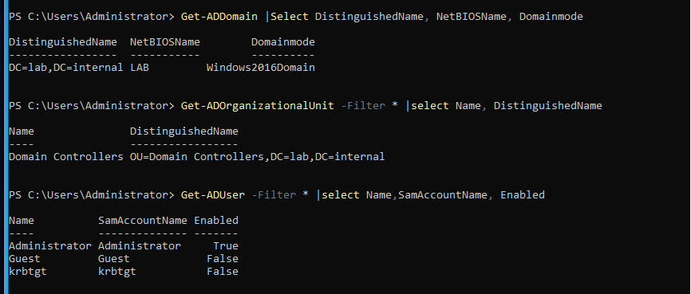{: width="866" height="369" }
_One OU (`Domain Controllers`) and three built-in users_

* The domain is `DC=lab,DC=internal`, NetBIOS name `LAB`. `Windows2016Domain` is the default functional level on Server 2022.
* The users are `Administrator` (enabled), and `Guest` and `krbtgt` (both disabled).

---

## Create an OU, a user and a group

An organisational unit (OU) is a folder inside the domain. Objects in an OU can be managed together, for example by linking a Group Policy to it.

```powershell
New-ADOrganizationalUnit -Name "Lab_test" -Path "DC=lab,DC=internal"

New-ADUser -Name "Test-User" -GivenName Test -Surname User -SamAccountName tuser `
  -UserPrincipalName tuser@lab.internal -Path "OU=Lab_test,DC=lab,DC=internal" `
  -AccountPassword (Read-Host -AsSecureString "Password") -Enabled $true

New-ADGroup -Name "GG-Test" -GroupScope Global -GroupCategory Security -Path "OU=Lab_test,DC=lab,DC=internal"
Add-ADGroupMember -Identity "GG-Test" -Members tuser
Get-ADUser tuser -Properties MemberOf | Select Name, MemberOf
```

* `Read-Host -AsSecureString` asks for the password with hidden input, so it never appears in the command or the shell history.
* `-GroupScope Global` is the standard type for a department's people. `-GroupCategory Security` means the group can hold permissions. `GG-` is the naming convention for a global group. Permissions go to groups, not to people.

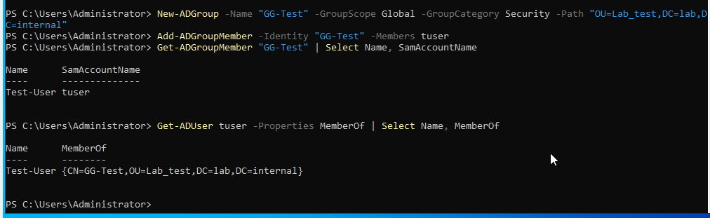{: width="1012" height="311" }
_The group lists the user, and the user's `MemberOf` lists the group_

If a password is refused, `New-ADUser` has already created the account: it creates the object first and sets the password afterwards. The account is left disabled. Reset the password on that account and enable it, instead of running the command again:

```powershell
Set-ADAccountPassword -Identity tuser -Reset -NewPassword (Read-Host -AsSecureString "New password")
Enable-ADAccount -Identity tuser
```

---

## Sign in as the new user

On WS01, sign in as `LAB\tuser`, a non-admin domain account:

```powershell
whoami
whoami /groups | Select-String "GG-Test"
```

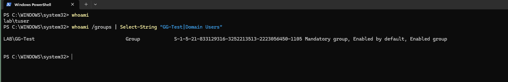{: width="1608" height="261" }
_`whoami` returns `lab\tuser`, and `LAB\GG-Test` is in the login token_

`LAB\GG-Test` is in the token, so the OU, user and group chain works end to end.

---

## Read the Kerberos event

The ticket request writes event 4768. Filter by account name:

```powershell
Get-WinEvent -LogName Security -FilterXPath "*[System[EventID=4768] and EventData[Data[@Name='TargetUserName']='tuser']]" -MaxEvents 1 | Format-List Message
```

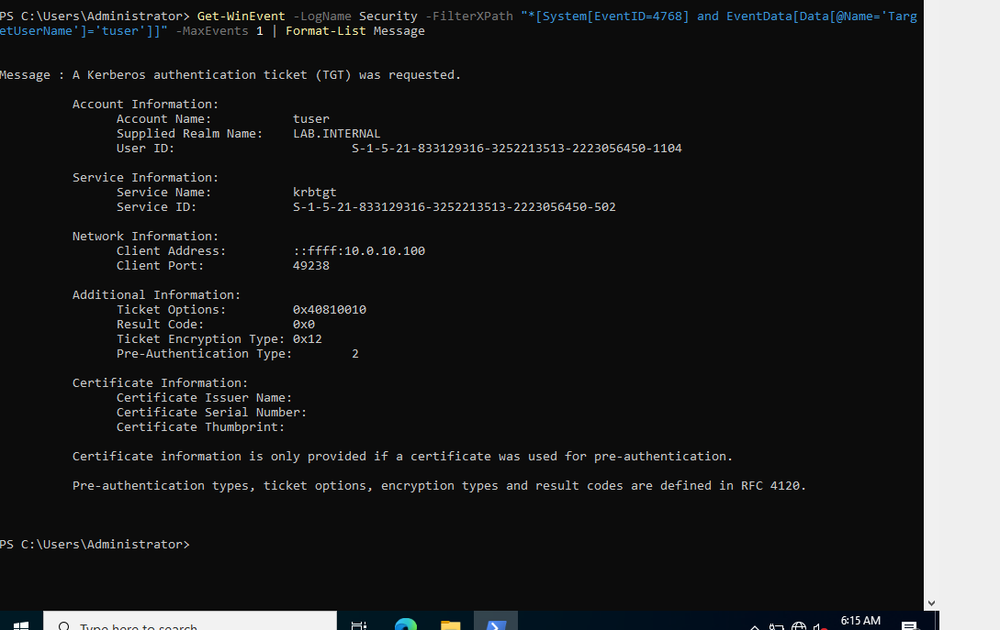{: width="1089" height="687" }
_A ticket-granting ticket request for `tuser`_

| Field | Value | Meaning |
|---|---|---|
| Account Name | `tuser` | Who asked for the ticket. |
| Service Name | `krbtgt` | A TGT request: the first ticket, which proves the login. |
| Client Address | `::ffff:10.0.10.100` | WS01 (the IPv4 address in IPv6 notation). |
| Result Code | `0x0` | Success. |
| Ticket Encryption Type | `0x12` | AES-256. |
| Pre-Authentication Type | `2` | The client proved its identity with an encrypted timestamp, as in a normal password login. |

A detection reads these fields. Pre-authentication type `0` would mean the account allows AS-REP roasting, `0x17` is RC4, a weaker cipher, and a non-zero result code means failure.

Filter by `TargetUserName` before you attribute an event to an account. An unfiltered query returns events for computers and services as well as people.

---

## Edit and move

```powershell
Set-ADUser tuser -Department "IT" -Title "Test Engineer" -Description "Manual exercise account"
New-ADOrganizationalUnit -Name "Lab_moved" -Path "DC=lab,DC=internal"
Move-ADObject -Identity (Get-ADUser tuser).DistinguishedName -TargetPath "OU=Lab_moved,DC=lab,DC=internal"
```

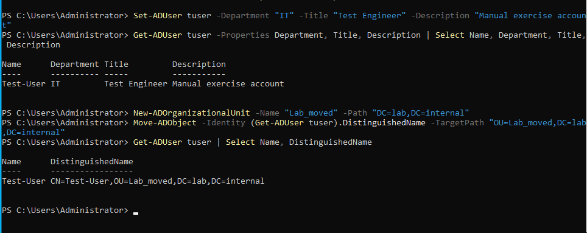{: width="964" height="383" }
_Three attributes set, then the user moved from `Lab_test` to `Lab_moved`_

The distinguished name changes, because it includes the OU. The SID and the login name stay the same. Group Policy attaches to OUs, so a move changes which policies apply. The group `GG-Test` does not move with the user.

---

## Delete an OU

Two protections stand in the way:

```powershell
Remove-ADOrganizationalUnit -Identity "OU=Lab_test,DC=lab,DC=internal" -Confirm:$false
```

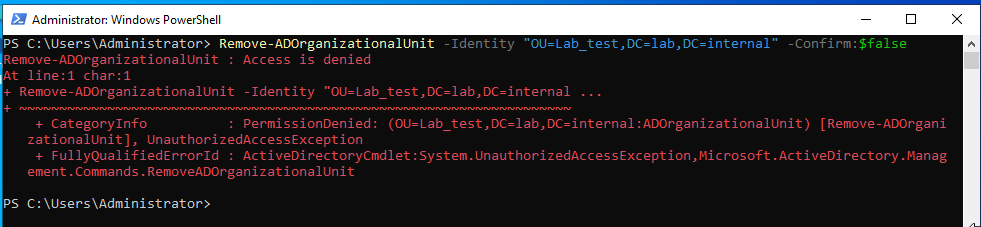{: width="981" height="227" }
_"Access is denied", even as a domain administrator_

1. **Protection from accidental deletion.** Windows adds a permission that denies deletion to everyone until the flag is cleared. The message says "access denied", not "protected":

   ```powershell
   Set-ADOrganizationalUnit -Identity "OU=Lab_test,DC=lab,DC=internal" -ProtectedFromAccidentalDeletion $false
   ```

2. **The OU must be empty.** Otherwise the delete fails with error 8332, "can only be performed on a leaf object". Remove the contents first, or add `-Recursive`:

   ```powershell
   Remove-ADOrganizationalUnit -Identity "OU=Lab_test,DC=lab,DC=internal" -Recursive -Confirm:$false
   ```

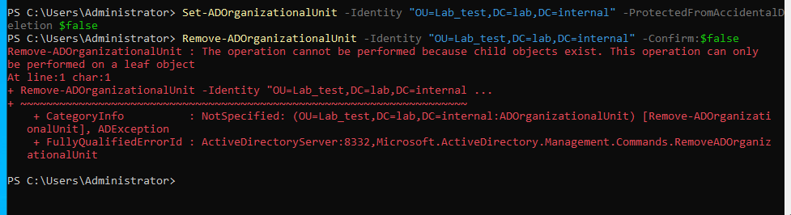{: width="977" height="266" }
_The OU still holds a group_

Every OU in the directory script keeps the default protection.

---

## Disable and enable

```powershell
Disable-ADAccount -Identity tuser
Enable-ADAccount -Identity tuser
```

Disabling writes event **4725**, and enabling writes event **4722**. A sign-in to the disabled account shows "Your account has been disabled" and tells whoever types the password that the account exists.

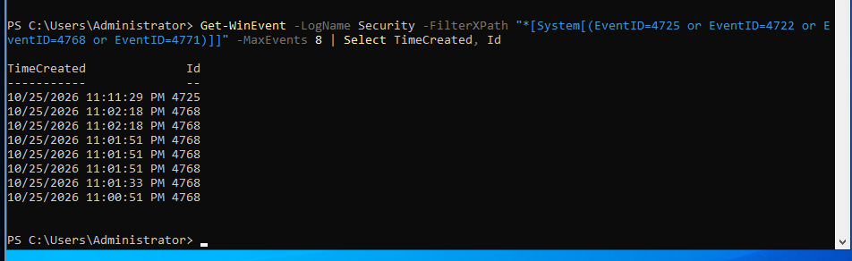{: width="952" height="292" }
_Event 4725, "an account was disabled"_

The sign-in attempt itself writes no failure event on DC01. The [post on logging](/posts/what-a-domain-controller-logs-and-what-it-doesnt/) explains why.

---

## The Recycle Bin: off and on

What survives a delete depends on the **AD Recycle Bin**. Check it first:

```powershell
Get-ADOptionalFeature -Filter 'Name -eq "Recycle Bin Feature"' | Select Name, EnabledScopes
```

`EnabledScopes` is empty on a new domain, so the Recycle Bin is off.

**Off.** Give the account a group, record what it has, take a snapshot, then delete it:

```powershell
New-ADGroup -Name "GG-Recover" -GroupScope Global -GroupCategory Security -Path "OU=Lab_moved,DC=lab,DC=internal"
Add-ADGroupMember -Identity "GG-Recover" -Members tuser
Get-ADUser tuser -Properties * | Select Name, SID, ObjectGUID, Department, Title, MemberOf
Remove-ADUser -Identity tuser -Confirm:$false
Get-ADObject -Filter 'isDeleted -eq $true -and samAccountName -eq "tuser"' -IncludeDeletedObjects -Properties * | Select Name, SamAccountName, LastKnownParent, ObjectSID, MemberOf, Department, Title
```

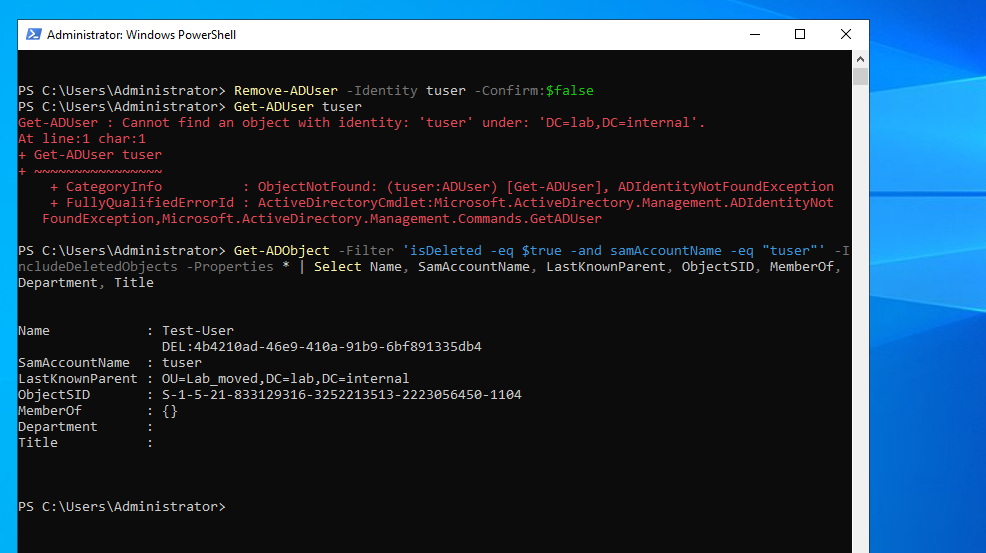{: width="986" height="553" }
_With the Recycle Bin off, the tombstone keeps the SID and the old location_

The deleted object is a tombstone. Its name is rewritten with `DEL:` and a GUID. The SID and last parent survive, and `MemberOf`, `Department` and `Title` are empty. `Restore-ADObject` fails:

```powershell
Get-ADObject -Filter 'isDeleted -eq $true -and samAccountName -eq "tuser"' -IncludeDeletedObjects | Restore-ADObject
```

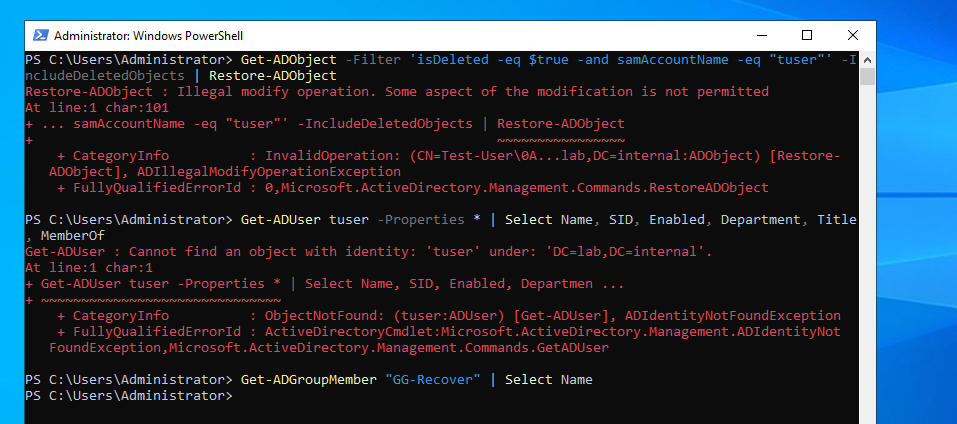{: width="957" height="424" }
_"Illegal modify operation": the user is still not found, and `GG-Recover` is empty_

**On.** Enabling the Recycle Bin is irreversible for the forest, so take a snapshot first. Then enable it and repeat the test with a new `tuser`:

```powershell
Enable-ADOptionalFeature -Identity 'Recycle Bin Feature' -Scope ForestOrConfigurationSet -Target 'lab.internal' -Confirm:$false
```

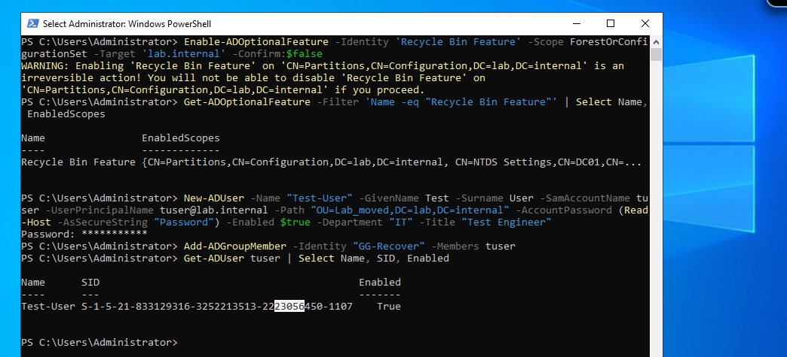{: width="1044" height="475" }
_The irreversible warning, the feature now listing its scopes, and the new account_

The new account has the same name and a different SID, because Active Directory identifies an account by its SID, not its name. Permissions given to the old SID do not apply to it. After the delete, the object keeps its attributes and group, and the restore works:

```powershell
Get-ADObject -Filter 'isDeleted -eq $true -and samAccountName -eq "tuser"' -IncludeDeletedObjects -Properties whenChanged | Sort-Object whenChanged -Descending | Select-Object -First 1 | Restore-ADObject
```

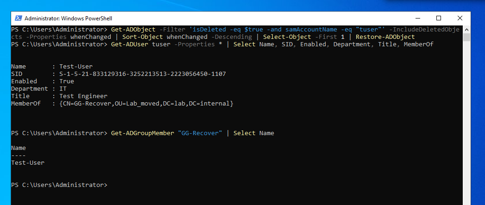{: width="1047" height="443" }
_The same SID, enabled, with department, title and group; `GG-Recover` has its member back_

| | Recycle Bin off | Recycle Bin on |
|---|---|---|
| Deleted object keeps | SID, old location | SID, old location, department, title, group membership |
| `Restore-ADObject` | Failed: "Illegal modify operation" | Worked |
| After the restore | Account not found, group empty | Same SID, groups restored, old password works |

Turn the Recycle Bin on before you need it.

---

## Clean up

Remove the test objects so the directory script starts from a clean state. The OU needs its protection cleared again:

```powershell
Remove-ADUser -Identity tuser -Confirm:$false
Remove-ADGroup -Identity GG-Recover -Confirm:$false
Set-ADOrganizationalUnit -Identity "OU=Lab_moved,DC=lab,DC=internal" -ProtectedFromAccidentalDeletion $false
Remove-ADOrganizationalUnit -Identity "OU=Lab_moved,DC=lab,DC=internal" -Confirm:$false
```

Check the directory against the baseline: one OU (`Domain Controllers`), the users `Administrator`, `Guest` and `krbtgt`, and no `GG-` groups.

---

## Notes

* **Read a command before you press Enter.** A missing comma in a `Select-Object` property list gives "A positional parameter cannot be found", and a misspelled property name returns an empty value.
* **A refused password leaves an account behind.** Reset it and enable it.
* **Turn on the Recycle Bin early.** Snapshot first, because it cannot be undone.
* **`whoami /groups` does not list `LAB\Domain Users`**, although the directory does. It is listed under the open items at the end of the series.

---

Next: [What a Domain Controller Logs, and What It Doesn't](/posts/what-a-domain-controller-logs-and-what-it-doesnt/)
