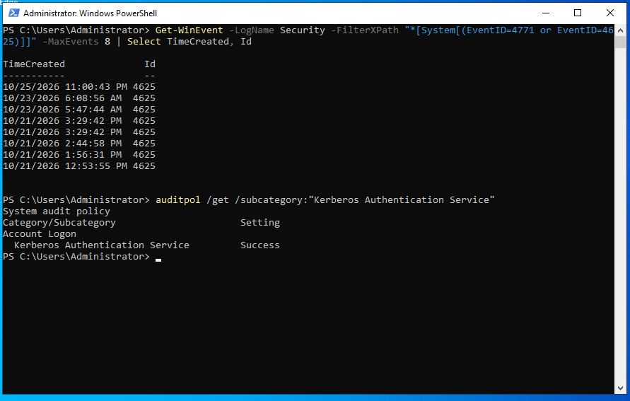
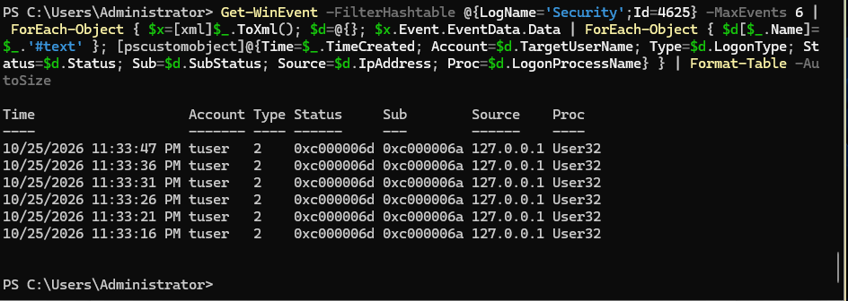
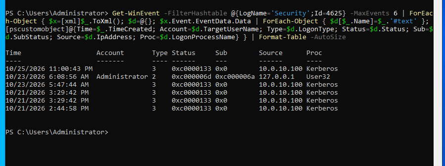

## Objective

Find out which authentication failures a fresh domain controller records. A detection can only match events that are written.

All commands run in an elevated PowerShell, on `DC01` unless a heading says `WS01`.

---

## Disabled account

A sign-in to a disabled account with the correct password is refused. Read the log on DC01:

```powershell
Get-WinEvent -LogName Security -FilterXPath "*[System[(EventID=4725 or EventID=4722 or EventID=4768 or EventID=4771)]]" -MaxEvents 8 | Select TimeCreated, Id
```

Event **4725** records the disabling. The sign-in attempt that followed has no failure event on DC01.

---

## Account lockout

```powershell
Get-ADDefaultDomainPasswordPolicy | Select MinPasswordLength, ComplexityEnabled, LockoutThreshold, LockoutDuration
```

On a new domain, the minimum password length is 7, complexity is enabled, and `LockoutThreshold` is **0**. A threshold of zero means accounts are never locked, however many wrong passwords are typed. The 30-minute duration only matters once a threshold is set. Anyone who can reach the domain controller can guess passwords without limit.

---

## Wrong passwords at the sign-in screen

After repeated wrong passwords on WS01, the sign-in screen slows down:

{: width="939" height="328" }
_"Invalid credentials, delaying next attempt..."_

This is not an account lockout. The workstation causes the delay, and it only slows whoever types at that keyboard. A network attacker never sees it.

Check what the domain controller recorded:

```powershell
Get-WinEvent -LogName Security -FilterXPath "*[System[(EventID=4771 or EventID=4625)]]" -MaxEvents 8 | Select TimeCreated, Id
auditpol /get /subcategory:"Kerberos Authentication Service"
```

{: width="891" height="567" }
_No event 4771, and Kerberos Authentication Service is set to Success only_

* **No event 4771.** 4771 is the Kerberos pre-authentication failure, the event a wrong password produces on the domain controller.
* **The audit setting explains it.** Kerberos Authentication Service is set to Success only, so failures are not recorded.

---

## What the workstation records

WS01 records its own failed interactive logons:

```powershell
Get-WinEvent -LogName Security -FilterXPath "*[System[EventID=4625]]" -MaxEvents 8 | Format-List TimeCreated, Message
```

{: width="944" height="336" }
_Six failed interactive logons for `tuser`, each with the wrong-password sub-status_

Each event shows:

* Account Name `tuser`, Account Domain `LAB`
* Logon Type `2` (interactive, at the keyboard)
* Status `0xC000006D` and Sub Status `0xC000006A`, "Unknown user name or bad password"
* Subject `WS01$`, logon process `User32`

Sub Status `0xC000006A` is the wrong-password code. `0xC0000072` would indicate a disabled account.

The workstation recorded the wrong passwords with the account name, and the domain controller recorded nothing. A defender who collects logs only from the domain controller misses password guessing at a keyboard.

---

## What the domain controller records

DC01 also writes event 4625, for failures on DC01 itself and for network logons:

{: width="899" height="335" }
_A wrong password at the DC01 console, and network logons from WS01 with status `0xC0000133`_

* An interactive logon (type `2`) at the DC01 console with a wrong password has the same shape as the WS01 events. Every machine audits failed logons on itself by default. Only the Kerberos failures on the domain controller are not recorded.
* Network logons (type `3`) from WS01's address with logon process `Kerberos` and status `0xC0000133` carry no account name. That status means the two clocks differ by more than five minutes, which Kerberos does not accept ([Microsoft documents the mapping](https://blogs.msdn.microsoft.com/asiatech/2009/04/26/kerberos-authentication-failed-due-to-time-skew/)).

The time setup that prevents these failures is in the [domain controller post](/posts/building-the-domain-controller/).

---

## Notes

* **Check the audit policy before you trust the log.** The absence of an event only means something if the event would have been recorded.
* **Collect workstation logs as well.** Failed interactive logons appear only on the machine where they happen.
* **Set an account lockout threshold.** The [hardening post](/posts/hardening-the-domain-password-lockout-and-legacy-protocols/) does it, and the [audit policy post](/posts/audit-policy-by-group-policy/) enables the missing events.

---

Next: [Building the Directory with a Script](/posts/building-the-directory-with-a-script/)
