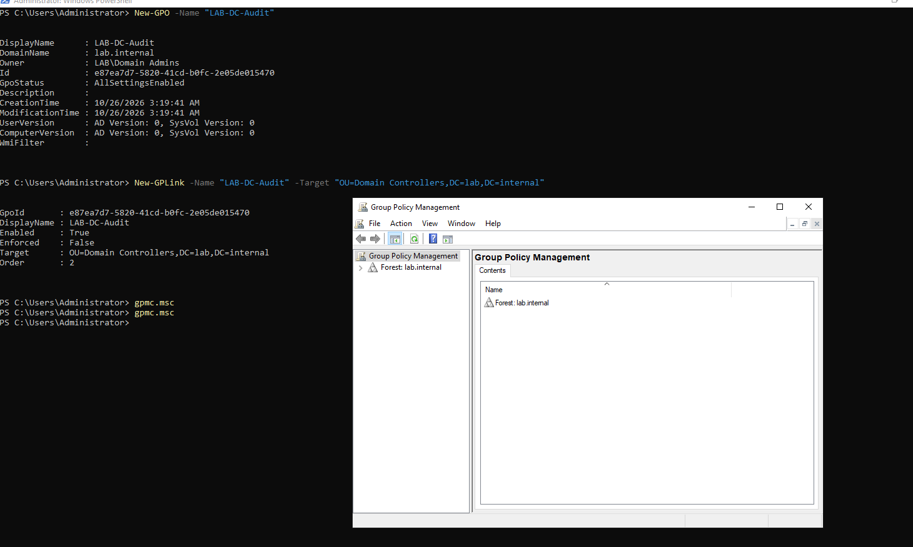
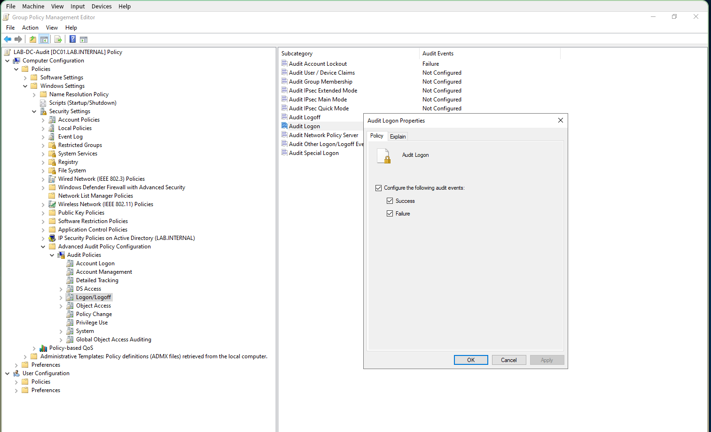
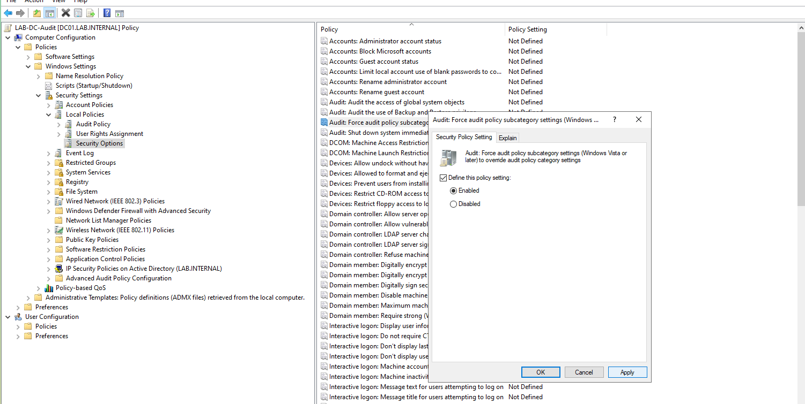
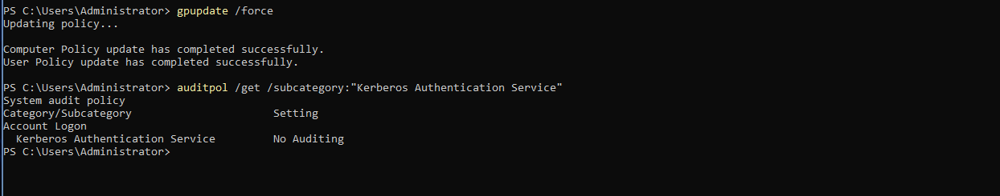
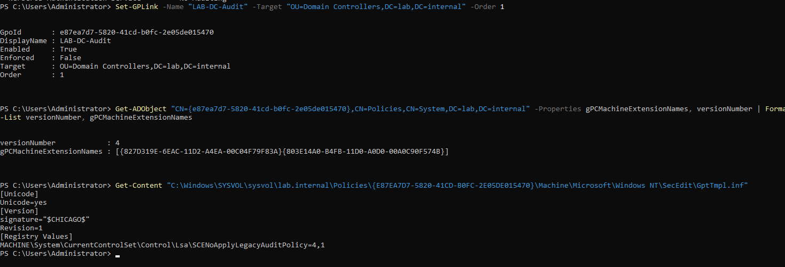
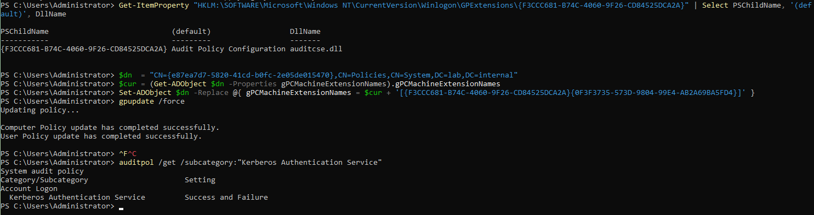
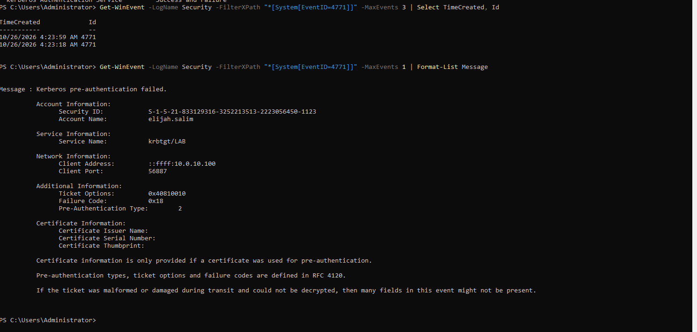

## Objective

Make the domain controller record failed Kerberos logons, so a detection for wrong passwords has an event to match.

---

## Create the policy

Create a policy object and link it to the Domain Controllers OU:

```powershell
New-GPO -Name "LAB-DC-Audit"
New-GPLink -Name "LAB-DC-Audit" -Target "OU=Domain Controllers,DC=lab,DC=internal"
```

{: width="1460" height="876" }
_`LAB-DC-Audit` linked to the Domain Controllers OU_

The new link has order 2, behind the built-in `Default Domain Controllers Policy`. Move it to 1, so it wins any conflict:

```powershell
Set-GPLink -Name "LAB-DC-Audit" -Target "OU=Domain Controllers,DC=lab,DC=internal" -Order 1
```

---

## Set the audit subcategories

In the editor, under **Advanced Audit Policy Configuration**, set:

| Category | Subcategory | Audit |
|---|---|---|
| Account Logon | Credential Validation, Kerberos Authentication Service, Kerberos Service Ticket Operations | Success and Failure |
| Account Management | User Account Management, Security Group Management | Success and Failure |
| Account Management | Computer Account Management | Success |
| DS Access | Directory Service Changes | Success |
| Logon/Logoff | Logon | Success and Failure |
| Logon/Logoff | Special Logon | Success |
| Logon/Logoff | Account Lockout | Failure |
| Detailed Tracking | Process Creation | Success |
| Policy Change | Audit Policy Change | Success |
| Privilege Use | Sensitive Privilege Use | Success and Failure |

Do not set `Non Sensitive Privilege Use`. It is noisy and not useful for detection.

{: width="1513" height="920" }
_Setting a subcategory in the policy editor_

Then enable **Audit: Force audit policy subcategory settings to override audit policy category settings** under Security Options. It makes Windows use the subcategories and ignore the old category-level settings. Leave the basic categories under Local Policies at **Not Defined**.

{: width="1501" height="755" }
_The override setting enabled_

Set all the Account Logon subcategories before you apply the policy. With the override on, a subcategory that isn't set reports `No Auditing`.

---

## Apply and check

```powershell
gpupdate /force
auditpol /get /subcategory:"Kerberos Authentication Service"
```

The result must be `Success and Failure`.

---

## When the policy applies but does nothing

If `auditpol` still says **No Auditing** for every subcategory, including the ones you set, the policy may have been received without its audit extension. Three checks show that the policy arrived:

* `gpresult /scope computer /r` lists `LAB-DC-Audit`.
* The policy's `audit.csv` in SYSVOL holds the rows you set.
* Its `GptTmpl.inf` holds `SCENoApplyLegacyAuditPolicy=4,1`, the override setting.

{: width="1244" height="245" }
_After `gpupdate`, the Kerberos Authentication Service subcategory says No Auditing_

Then read the extension list in the policy's record in Active Directory. A computer runs only the extensions that the record lists:

```powershell
Get-ADObject "CN={e87ea7d7-5820-41cd-b0fc-2e05de015470},CN=Policies,CN=System,DC=lab,DC=internal" -Properties gPCMachineExtensionNames | Format-List gPCMachineExtensionNames
```

{: width="1469" height="502" }
_Only the security settings extension is listed. The audit extension is missing._

The key `{F3CCC681-B74C-4060-9F26-CD84525DCA2A}` under `Winlogon\GPExtensions` on DC01 is named `Audit Policy Configuration` and points to `auditcse.dll`. Append the audit extension pair to the policy's list. Replace the GUID with your policy's:

```powershell
$dn  = "CN={e87ea7d7-5820-41cd-b0fc-2e05de015470},CN=Policies,CN=System,DC=lab,DC=internal"
$cur = (Get-ADObject $dn -Properties gPCMachineExtensionNames).gPCMachineExtensionNames
Set-ADObject $dn -Replace @{ gPCMachineExtensionNames = $cur + '[{F3CCC681-B74C-4060-9F26-CD84525DCA2A}{0F3F3735-573D-9804-99E4-AB2A69BA5FD4}]' }
gpupdate /force
```

Append the pair once. Running the command again adds a duplicate entry.

{: width="1485" height="394" }
_`auditpol` now says Success and Failure_

---

## Verify

Enter a wrong password for a test account on WS01, then read the event on DC01:

```powershell
Get-WinEvent -LogName Security -FilterXPath "*[System[EventID=4771]]" -MaxEvents 1 | Format-List Message
```

{: width="1494" height="713" }
_Event 4771: the account, `krbtgt/LAB`, WS01's address, and failure code `0x18`_

Event **4771** names the account, the service `krbtgt/LAB`, the source machine and **Failure Code `0x18`**, which is a wrong password. A failed login is now recorded on the domain controller with the account, the source and the reason.

---

## Notes

* **Check `auditpol` after the first subcategory.** Checking after a whole list of settings hides which one failed.
* **Check the extension list when a policy applies and does nothing.** `gpresult` showing a policy as applied does not mean every setting in it was read.

---

Next: [Hardening the Domain: Password Policy, Lockout and Legacy Protocols](/posts/hardening-the-domain-password-lockout-and-legacy-protocols/)
