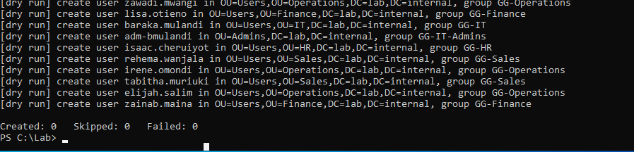
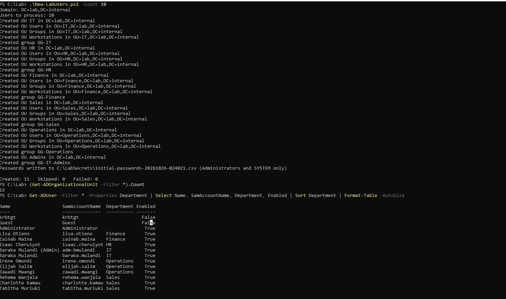
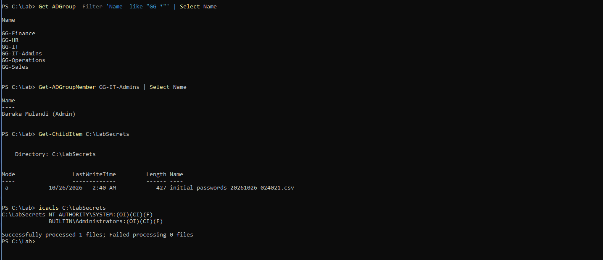
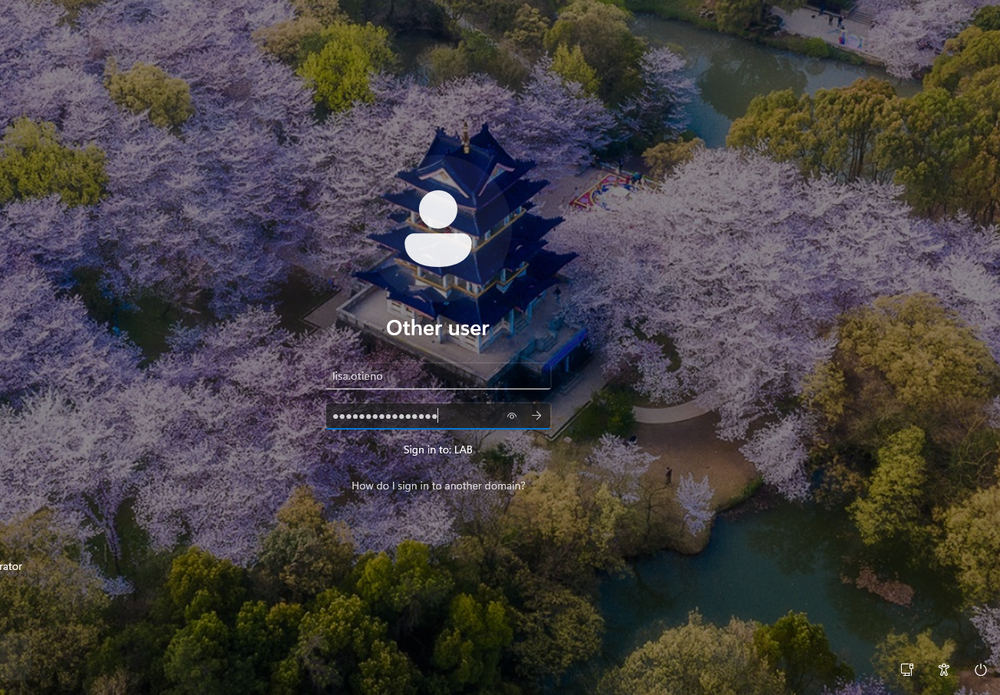
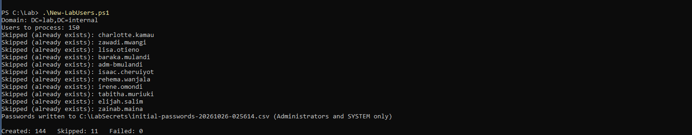
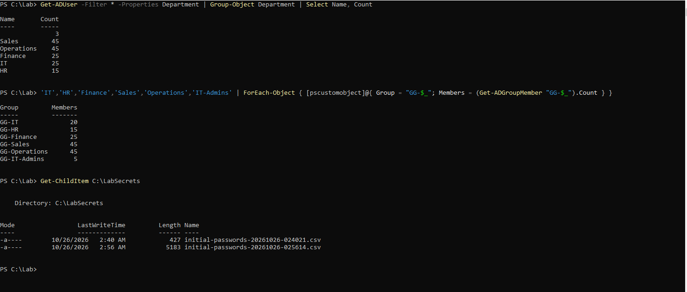

## Objective

Build the lab's directory with a script that can be run again: five department OUs, groups, 150 users and five admin accounts.

The lab needs 150 users because detections such as password spraying and Kerberoasting only stand out among many accounts. With ten users, any attack is obvious. The files are in the [repository](https://github.com/Mulandii/hybrid-identity-detection-lab) under `scripts/`.

---

## Design

| Object | Detail |
|---|---|
| OUs | `IT`, `HR`, `Finance`, `Sales`, `Operations`, each with `Users`, `Groups` and `Workstations`, plus `Admins`. All keep the deletion protection. |
| Groups | `GG-<Department>` for each department, and `GG-IT-Admins`. |
| Users | 150: IT 20, HR 15, Finance 25, Sales 45, Operations 45. |
| Admin accounts | The first five IT staff also get an `adm-` account in `Admins`, so daily accounts never hold admin rights. Nobody is in Domain Admins. |

Two files do the work:

* `generate-users.py` writes `users.csv` from a fixed seed, so the same 150 users come out every time. It holds no passwords.
* `New-LabUsers.ps1` reads the CSV and builds everything. It skips anything that exists, so it can run twice. `-DryRun` shows what it would do, and `-Count N` uses only the first N rows.

The names are Kenyan first and last names from fixed lists, plus a few required ones. The CSV is ordered so that any first N rows contain a mix of departments, which makes a small test representative.

### Passwords

Each account gets a random 16-character password from `RandomNumberGenerator`, with at least one upper-case letter, lower-case letter, digit and symbol, then shuffled. The script never prints them. It writes them to one CSV on DC01, in `C:\LabSecrets`, readable only by Administrators and SYSTEM. The repository's `.gitignore` blocks files like it, so the passwords never reach the repository or this blog.

---

## Run it

Run the script on DC01, from the folder that holds it, in an elevated PowerShell. Start with a dry run, so nothing is created before you have read the output:

```powershell
.\New-LabUsers.ps1 -DryRun
```

{: width="897" height="216" }
_The dry run: nothing created, nothing failed_

The dry run lists each OU, group and user it would create and ends with `Created: 0   Skipped: 0   Failed: 0`. It never reaches the code that creates accounts, so the first real run is the first test of that code.

### Ten users

```powershell
.\New-LabUsers.ps1 -Count 10
```

{: width="1478" height="876" }
_OUs, groups and 11 accounts created_

`Created: 11` is the ten users plus one admin account. There are 22 OUs: `Domain Controllers`, five departments, 15 sub-OUs and `Admins`.

{: width="1435" height="620" }
_Six groups, the admin group member, and the password file's permissions_

Six `GG-` groups exist, `GG-IT-Admins` holds the admin account, and the password file lists only `SYSTEM` and `Administrators`. Read one password on DC01, without copying it, and sign in to WS01 with it:

{: width="1303" height="906" }
_Signing in to WS01 with a generated password_

The sign-in works, so the generator, the account setup and the password file are confirmed together. Running the same command again prints `Skipped (already exists)` for every account.

### All 150

```powershell
.\New-LabUsers.ps1
```

{: width="1487" height="292" }
_The first 11 skipped, 144 created, none failed_

The result is `Created: 144   Skipped: 11   Failed: 0`. The skipped accounts are the 11 from the first run. Check the counts:

{: width="1490" height="635" }
_Users per department, members per group, and the two password files_

IT shows 25 users because it includes the five admin accounts. The three with no department are the built-in `Administrator`, `Guest` and `krbtgt`. Each group has the member count in the design table, and there is one password file per run.

The directory now holds 155 accounts: 150 users and 5 admin accounts. Take a snapshot of DC01 before any hardening.

---

## Notes

* **Run a dry run first.** It catches most mistakes before any account exists.
* **Keep a PowerShell installation on your workstation.** A script that has been checked by a parser before it reaches the domain controller costs less to debug.
* **Keep generated passwords out of the repository.** Block the file pattern in `.gitignore` before the first run.

---

Next: [Audit Policy by Group Policy](/posts/audit-policy-by-group-policy/)
