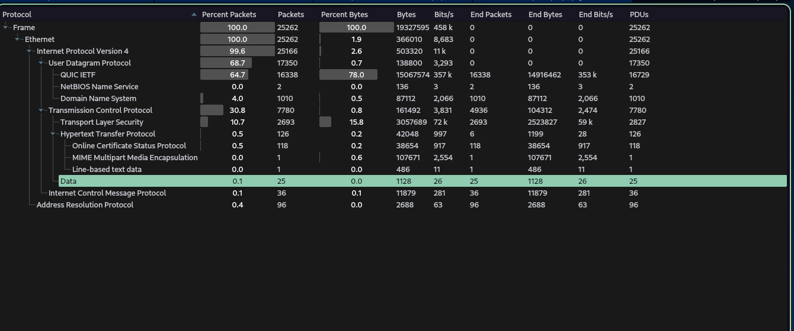
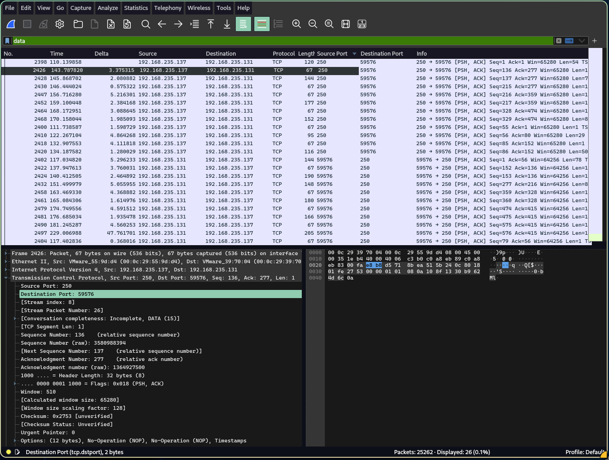
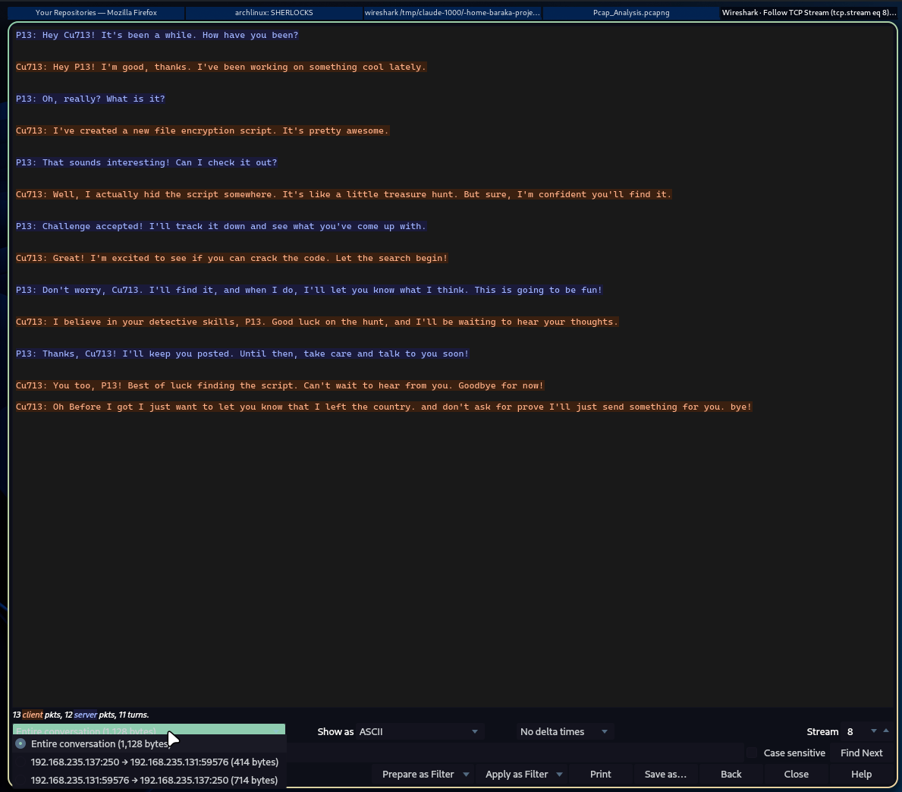
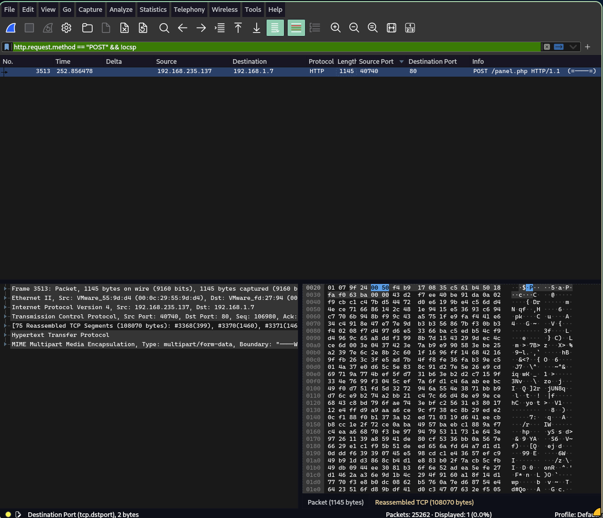
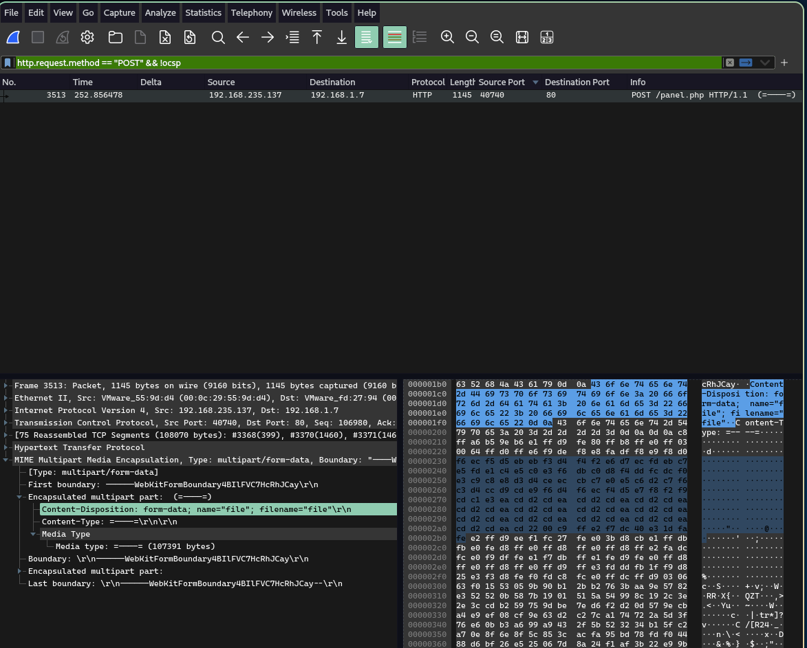
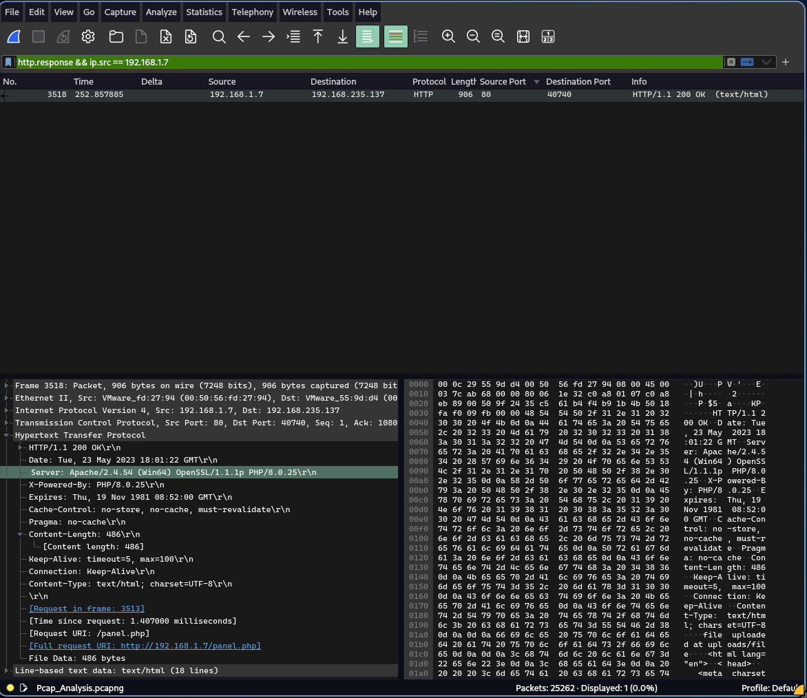
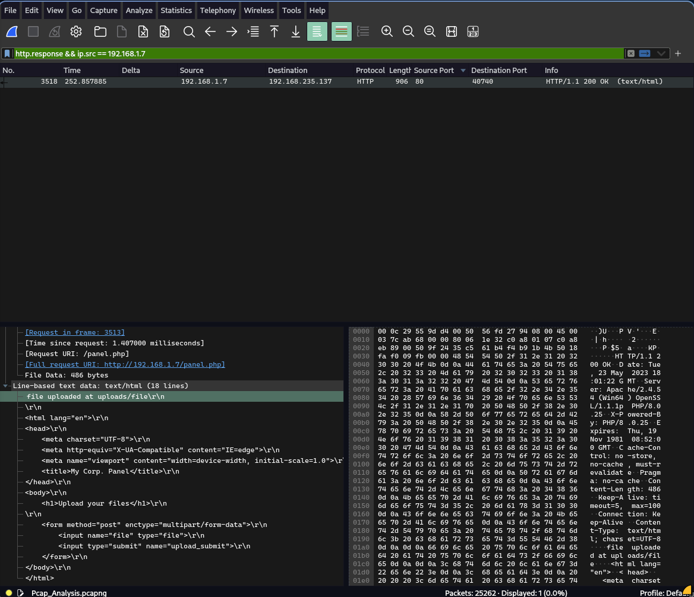

**Prepared by:** Mulandii · **Difficulty:** Very Easy

## Description

A packet capture taken from a user's computer holds a plain-text chat and an HTTP file upload hidden among thousands of encrypted packets. We have to find who talked to whom, where the file went, and how the upload looked on the wire.

## Scenario

> We have captured this traffic from P13's computer. Can you help him?

## Artifacts Provided

`PCAP_Analysis.zip` (SHA-256 `1c30999cc3473342db6f6a0c655a8f90cf499980111a4c545104b02e963bb500`), password `hacktheblue`, containing one file, `Pcap_Analysis.pcapng`.

## Skills Learnt

* Triage of a large capture with the Protocol Hierarchy
* Wireshark display filters and Follow TCP Stream
* Reading HTTP requests and responses, including multipart uploads
* Measuring a connection's duration from its packets

## Initial Analysis

```bash
unzip -P hacktheblue PCAP_Analysis.zip
sha256sum Pcap_Analysis.pcapng
capinfos Pcap_Analysis.pcapng
```

| Field | Value |
|---|---|
| Packets | 25,262 |
| Duration | 337 seconds |
| Captured | 2023-05-23, 17:57 to 18:02 UTC |
| Capture interface | VMware Network Adapter VMnet8 |
| SHA-256 of the pcap | `97e9b5e4a2c0e5bbc924f5d4edf5c5f67951f770059d69f5c6f820ecc932865b` |

VMnet8 is the adapter VMware uses for its NAT network, so the capture was taken on a host running virtual machines.

Reading 25,000 packets one by one is not realistic, so we start with **Statistics → Protocol Hierarchy**, which shows every protocol and how much of the capture it takes up:


_Protocol Hierarchy of the capture_

| Protocol | Packets | Share of bytes | Readable? |
|---|---|---|---|
| QUIC | 16,338 | 78.0% | No, encrypted |
| TLS | 2,693 | 15.8% | No, encrypted |
| DNS | 1,010 | 0.5% | Yes |
| HTTP | 126 | 0.2% | Yes |
| MIME Multipart | 1 | 0.6% | Yes |
| Data | 25 | under 0.1% | Unidentified |

Almost everything is encrypted browsing, which we skip. Two rows are worth following:

* **Data** (25 packets): payload that Wireshark could not identify as a known protocol.
* **HTTP** (126 packets): 118 of them are OCSP certificate checks, which leaves 8 that are something else. One carries a **MIME Multipart** body of 107,671 bytes in a single request, which is the signature of a file upload.

## Questions

### 1. In network communication, what are the IP addresses of the sender and receiver?

We start with the unidentified traffic, using the display filter `data`:


_The `data` packets, with the TCP ports added as columns_

The filter shows 26 packets, one more than the Protocol Hierarchy listed. 25 are TCP segments between the same two endpoints on port **250**, and the 26th is frame 3513, the file upload from Question 2. Its file part has an unknown content type (`=----=`), so Wireshark labels those bytes `data` too.

In the 25 chat packets one side always uses the fixed port 250, and the other always uses the same random high port, 59576. The high port is the client and the fixed port is the listener. **Follow → TCP Stream** shows the conversation:


_Follow TCP Stream on port 250_

```
P13: Hey Cu713! It's been a while. How have you been?
Cu713: Hey P13! I'm good, thanks. I've been working on something cool lately.
P13: Oh, really? What is it?
Cu713: I've created a new file encryption script. It's pretty awesome.
P13: That sounds interesting! Can I check it out?
Cu713: Well, I actually hid the script somewhere. It's like a little treasure hunt. ...
```

The chat ends with Cu713 saying they have left the country and will send something instead. The window footer agrees with the Protocol Hierarchy: 13 client packets and 12 server packets make the 25 `data` packets, totalling 1,128 bytes.

The TCP handshake shows who opened the connection:

```bash
tshark -r Pcap_Analysis.pcapng -Y 'tcp.port==250 && tcp.flags.syn==1' \
  -T fields -e ip.src -e ip.dst -e tcp.flags
```

```
192.168.235.131   192.168.235.137   0x0002   (SYN)
192.168.235.137   192.168.235.131   0x0012   (SYN, ACK)
```

`192.168.235.131` opened the connection, so it is the TCP client. But "sender" is not "client". The first data packet in the conversation is frame 2398, sent by `192.168.235.137` (P13) to `192.168.235.131` (Cu713), and the scenario says the traffic was captured from P13's computer. We take the host that sent the data first as the sender.

**Answer:** `192.168.235.137` (sender) and `192.168.235.131` (receiver)

### 2. P13 uploaded a file to the web server. What is the IP address of the server?

An upload sends data, and HTTP sends data with `POST`:

```
http.request.method == "POST" && !ocsp
```

We add `!ocsp` because most POSTs in the capture are background certificate checks. One request remains:


_The only non-OCSP POST in the capture_

```bash
tshark -r Pcap_Analysis.pcapng -Y 'http.request.method == "POST" && !ocsp' \
  -T fields -e frame.number -e ip.src -e ip.dst -e http.request.uri
```

```
3513   192.168.235.137   192.168.1.7   /panel.php
```

The request goes to `192.168.1.7`, which appears in no other connection in the capture, so the whole exchange with this server is a single TCP stream.

**Answer:** `192.168.1.7`

### 3. What is the name of the file that was sent through the network?

We select the request and expand **MIME Multipart Media Encapsulation** in the Packet Details pane:


_The multipart section of the request_

```
------WebKitFormBoundary4BIlFVC7HcRhJCay
Content-Disposition: form-data; name="file"; filename="file"
Content-Type: =----=
```

`name="file"` is the name of the HTML form field, and `filename="file"` is the name of the uploaded file. The server confirms it in its reply (Question 5).

We also exported the body with **File → Export Objects → HTTP** and checked the file inside the wrapper:

| Property | Value |
|---|---|
| Size | 107,391 bytes |
| Known file signature | none (`file` reports `data`) |
| Entropy | 7.99 bits per byte |

An entropy that close to 8 means the bytes look random, which is what compressed or encrypted data looks like. That fits the "encrypted file" in the scenario, but this check alone does not prove what the file contains.

**Answer:** `file`

### 4. What web server software is running on the target machine?

The server describes itself in its response headers. We filter for the reply with `http.response && ip.src == 192.168.1.7`, which leaves one packet (frame 3518), and expand **Hypertext Transfer Protocol**:


_The server's 200 OK response, frame 3518, with the `Server` header selected_

```
HTTP/1.1 200 OK
Date: Tue, 23 May 2023 18:01:22 GMT
Server: Apache/2.4.54 (Win64) OpenSSL/1.1.1p PHP/8.0.25
X-Powered-By: PHP/8.0.25
```

The web server is Apache 2.4.54, built for 64-bit Windows, running PHP 8.0.25.

**Answer:** `Apache` (full banner: `Apache/2.4.54 (Win64) OpenSSL/1.1.1p PHP/8.0.25`)

### 5. What directory was the file uploaded to?

The body of the same response says where the file went. It is in **Line-based text data** at the bottom of the details pane:


_The body of the response_

```
file uploaded at uploads/file
```

The page that follows is a simple form titled "My Corp. Panel". The `200 OK` status and the message together show the upload succeeded.

**Answer:** `uploads`

### 6. How long did it take the sender to send the encrypted file?

The upload is one TCP connection, so its duration is the answer. **Statistics → Conversations → TCP**, with **Limit to display filter** ticked and the filter `ip.addr == 192.168.1.7`, or on the command line:

```bash
tshark -r Pcap_Analysis.pcapng -q -z conv,tcp | grep '192.168.1.7:80'
```

```
192.168.235.137:40740 <-> 192.168.1.7:80   159 frames   117 kB   252.852088   0.0073
```

We cross-checked it against the packet timestamps:

| Event | Frame | Seconds since capture start |
|---|---|---|
| SYN (connection opens) | 3365 | 252.852088 |
| First part of the request | 3368 | 252.852844 |
| Server `200 OK` | 3518 | 252.857885 |
| Last ACK (connection closes) | 3523 | 252.859398 |

The connection lasted 0.0073 seconds, about 7.3 milliseconds.

**Answer:** `0.0073` seconds

## Summary

P13 held a plain-text chat with Cu713 on an unusual port, 250. Separately, P13's machine uploaded a 107,391-byte file, named `file` and almost perfectly random, to an Apache server at `192.168.1.7`. The server stored it under `uploads/` and answered `200 OK`. The whole upload took 7.3 milliseconds.

The capture shows the file going out. It does not show where the file came from, and we did not decrypt it. The names P13 and Cu713 come from the chat text and cannot be verified from the network.


_PCAP Analysis solved on 28 Oct 2026, Sherlock rank #1993_
