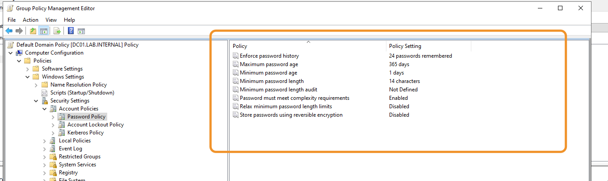
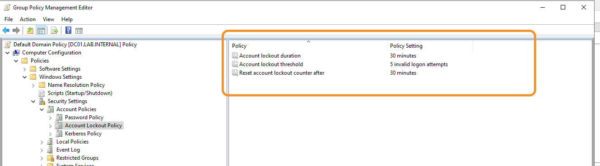
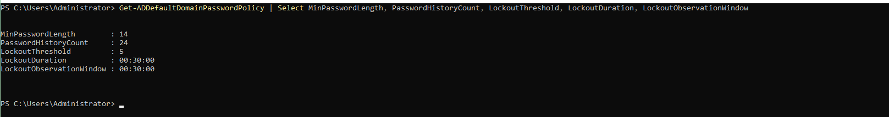
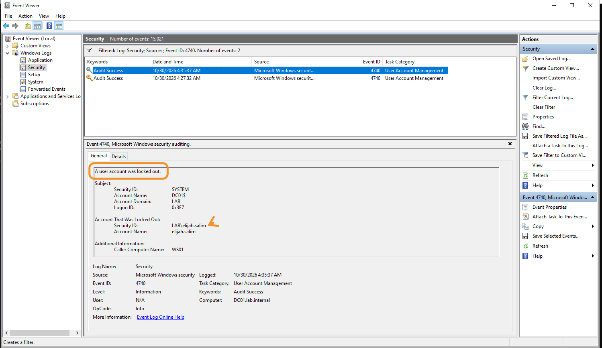
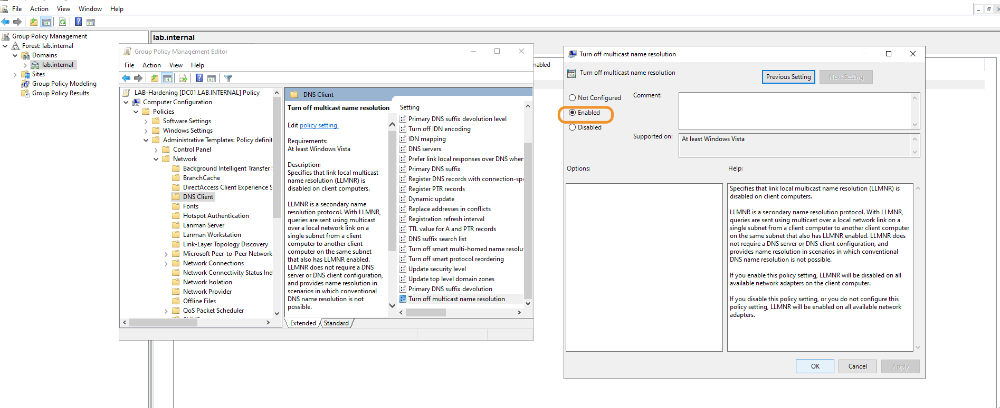
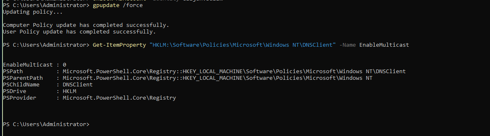
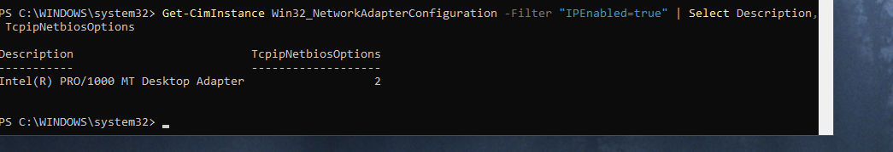
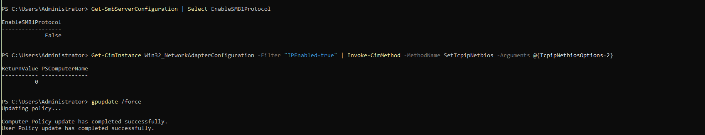
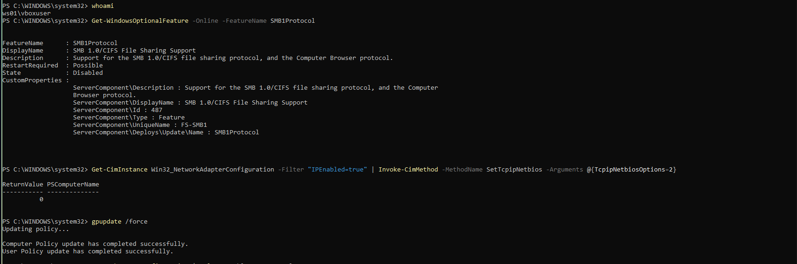

## Objective

Make password guessing harder, and remove three legacy protocols that attackers use to capture or relay credentials. Each setting is applied by Group Policy where possible, and verified on the machine that uses it.

Take a snapshot before you start. The weak starting state is kept in `phase1-dc01-150-users`.

---

## Password and lockout policy

Account policies apply to domain accounts only when they are set in a GPO linked to the domain. A value in a policy linked to an OU, such as `LAB-DC-Audit` on the Domain Controllers OU, has no effect on domain accounts. Set them in the **Default Domain Policy**, under Computer Configuration → Policies → Windows Settings → Security Settings → Account Policies.

| Setting | Value |
|---|---|
| Enforce password history | 24 |
| Maximum password age | 365 days |
| Minimum password age | 1 day |
| Minimum password length | 14 |
| Password must meet complexity requirements | Enabled |
| Store passwords using reversible encryption | Disabled |
| Relax minimum password length limits | Disabled |
| Account lockout threshold | 5 invalid attempts |
| Account lockout duration | 30 minutes |
| Reset account lockout counter after | 30 minutes |

Keep the Kerberos policy at its defaults: service ticket 600 minutes, user ticket 10 hours, renewal 7 days, clock tolerance 5 minutes.

* **Maximum age:** 365 days is a lab choice. NIST advises against forced periodic changes, and CIS allows a long maximum.
* **Minimum length:** 14 characters follows CIS.
* **Reversible encryption:** it stores passwords in a form that is close to plain text.

{: width="1000" height="350" }
_The password settings_

{: width="1000" height="260" }
_The lockout settings_

After `gpupdate /force` on DC01, read the effective values:

```powershell
Get-ADDefaultDomainPasswordPolicy | Select MinPasswordLength, PasswordHistoryCount, LockoutThreshold, LockoutDuration, LockoutObservationWindow
```

{: width="1000" height="200" }
_14, 24, 5, 30 minutes and 30 minutes_

Existing passwords keep working until they are changed. The policy applies at the next password change. The generated 16-character passwords already comply.

### Test the lockout

On WS01, enter five wrong passwords for a test account at the sign-in screen. The next attempt shows the lockout:

{: width="1000" height="530" }
_WS01 displays the lockout. The domain controller enforces it._

DC01 records event **4740**:

{: width="1000" height="560" }
_Subject `DC01$`, locked-out account `LAB\elijah.salim`, caller computer `WS01`_

Three fields matter for detection: the subject (which machine wrote the event), the account that was locked out, and the caller computer (the source of the attempts).

Unlock the account:

```powershell
Unlock-ADAccount -Identity elijah.salim
```

---

## LLMNR

Link-Local Multicast Name Resolution is a fallback. When DNS cannot resolve a name, Windows broadcasts the query on the local subnet, and any host there can answer. An attacker can answer and collect the authentication attempts that follow.

Disable it with a GPO, `LAB-Hardening`, linked to the domain:

Computer Configuration → Policies → Administrative Templates → Network → DNS Client → **Turn off multicast name resolution: Enabled**

{: width="1000" height="450" }
_The policy sets `EnableMulticast` to 0_

This is a computer setting, so each machine applies it itself. After `gpupdate /force`, check on each machine:

```powershell
Get-ItemProperty "HKLM:\Software\Policies\Microsoft\Windows NT\DNSClient" -Name EnableMulticast
```

The value must be `0`.

{: width="1000" height="330" }
_`EnableMulticast 0` on DC01_

---

## NetBIOS over TCP/IP

The NetBIOS name service has the same spoofing risk. Group Policy cannot set it directly, so set it on each adapter. The value `2` disables it:

```powershell
Get-CimInstance Win32_NetworkAdapterConfiguration -Filter "IPEnabled=true" | Invoke-CimMethod -MethodName SetTcpipNetbios -Arguments @{TcpipNetbiosOptions=2}
Get-CimInstance Win32_NetworkAdapterConfiguration -Filter "IPEnabled=true" | Select Description, TcpipNetbiosOptions
```

The method returns `0` for success, and the second command must show `2`.

{: width="1000" height="220" }
_`TcpipNetbiosOptions 2` on WS01_

The setting belongs to the adapter, so check it again if a machine gets a new adapter.

---

## SMBv1

SMBv1 has known remote-code-execution flaws, and nothing in the lab needs it. Check both machines:

```powershell
Get-SmbServerConfiguration | Select EnableSMB1Protocol
Get-WindowsOptionalFeature -Online -FeatureName SMB1Protocol | Select FeatureName, State
```

`EnableSMB1Protocol` must be `False`, and the feature must be `Disabled`. If it is enabled, disable it:

```powershell
Set-SmbServerConfiguration -EnableSMB1Protocol $false -Force
Disable-WindowsOptionalFeature -Online -FeatureName SMB1Protocol -NoRestart
```

{: width="1000" height="350" }
_DC01: `EnableSMB1Protocol False`_

{: width="1000" height="600" }
_WS01: `SMB1Protocol` is `Disabled`_

Restart each machine before you check, so that an earlier change shows its final state.

---

## Notes

* **Set account policies in a domain-linked GPO.** Elsewhere they have no effect on domain accounts.
* **Check each setting where it applies.** Password and lockout values are checked on the domain controller, and LLMNR, NetBIOS and SMBv1 on each machine.
* **Restart before you check a machine.** A change can show its old value until the restart.
* **Run policy commands as `LAB\Administrator`.**

---

Next: [Turning on the Windows Firewall Without Breaking the Domain](/posts/turning-on-the-windows-firewall-without-breaking-the-domain/)
