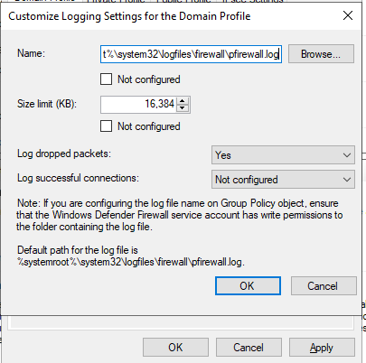
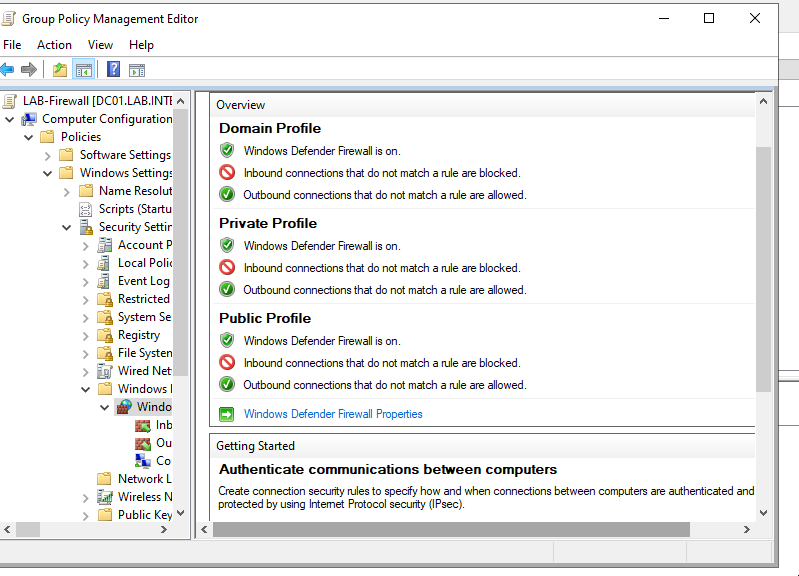
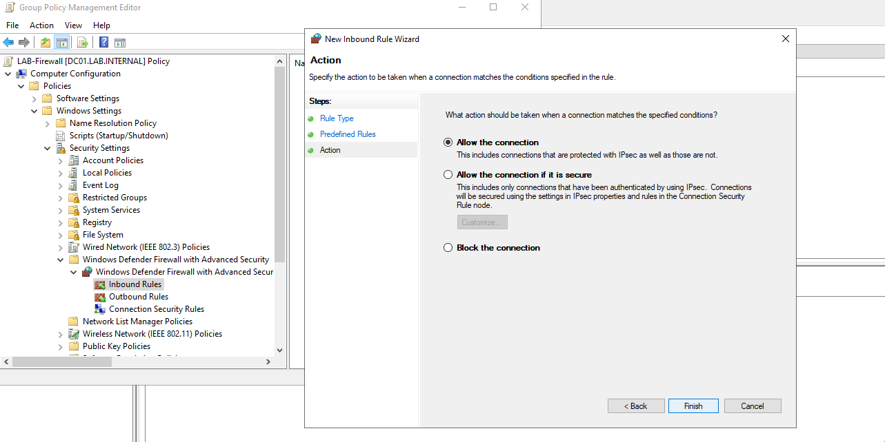
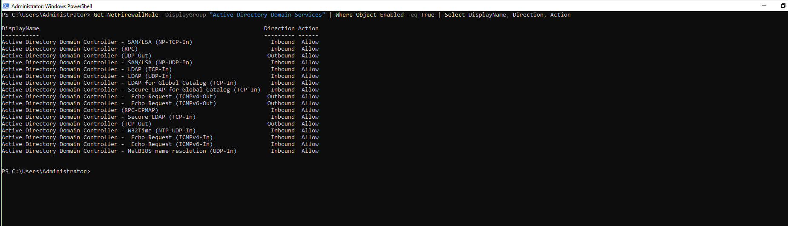
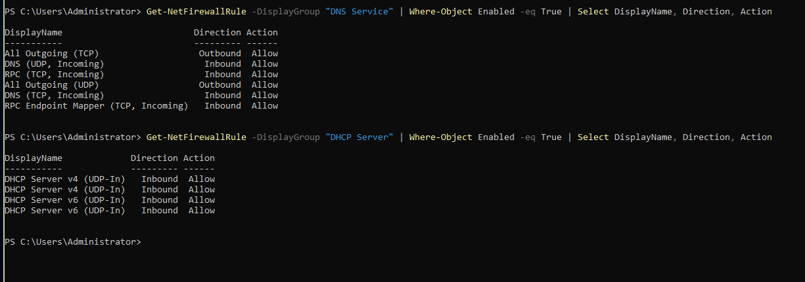
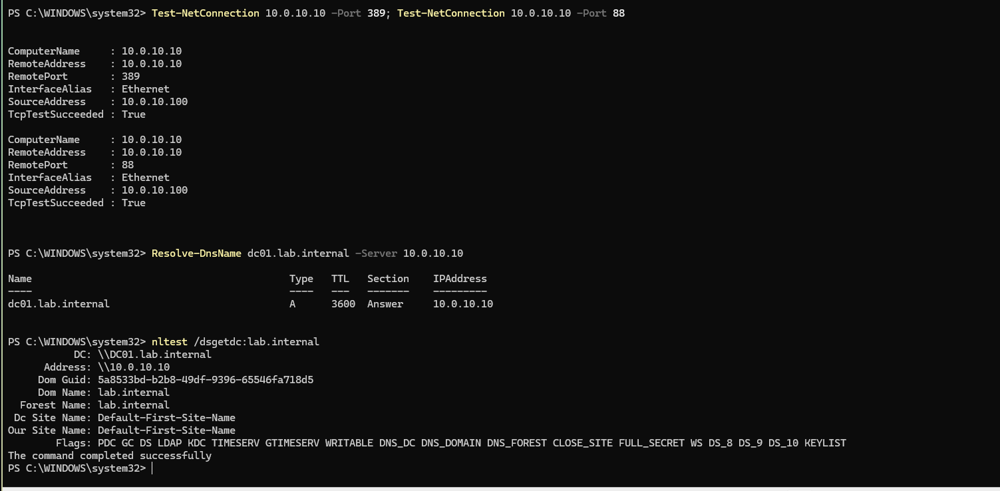

## Objective

Block unsolicited inbound traffic on every domain machine, and allow only what the domain needs. A closed inbound firewall gives an attacker who reaches the lab network fewer services to attack. Setting it in Group Policy gives every machine the same rules.

---

## The policy

Create a GPO, `LAB-Firewall`, linked to the domain. Set the same values for the Domain, Private and Public profiles:

| Setting | Value |
|---|---|
| Firewall state | On |
| Inbound connections | Block |
| Outbound connections | Allow |
| Log dropped packets | Yes |
| Log size | 16,384 KB |

{: width="1000" height="450" }
_The log size set to 16,384 KB_

{: width="1000" height="600" }
_The overview for the three profiles_

---

## Allow rules first

A domain needs inbound traffic on its services. Add three predefined rule sets in the GPO's Inbound Rules. Each predefined choice in the New Rule wizard adds one service, so run the wizard once per service, and set each to **Allow the connection**:

* **Active Directory Domain Services:** LDAP, Global Catalog, the SAM/LSA ports, RPC and W32Time
* **DNS Service:** TCP and UDP 53, and the RPC endpoint mapper
* **DHCP Server:** DHCPv4 and DHCPv6, UDP

{: width="1000" height="600" }
_Allow the connection_

Check that the rules exist on DC01:

```powershell
Get-NetFirewallRule -DisplayGroup "Active Directory Domain Services" | Where-Object Enabled -eq True | Select DisplayName, Direction, Action
Get-NetFirewallRule -DisplayGroup "DNS Service" | Where-Object Enabled -eq True | Select DisplayName, Direction, Action
Get-NetFirewallRule -DisplayGroup "DHCP Server" | Where-Object Enabled -eq True | Select DisplayName, Direction, Action
```

{: width="1000" height="530" }
_The AD DS rule set_

{: width="1000" height="450" }
_The DNS and DHCP rule sets_

---

## Then block inbound

Add the allow rules before you set inbound to **Block**. With the block on and no rules, WS01 cannot sign in with a domain account. If that happens, set inbound back to **Not configured**, add the rules, and block again.

Apply the policy on both machines:

```powershell
gpupdate /force
```

---

## Verify

Check the firewall policy that is in effect, on DC01 and on WS01:

```powershell
netsh advfirewall show domainprofile
```

The `Firewall Policy` line must read `BlockInbound,AllowOutbound`. `Get-NetFirewallProfile` reports `NotConfigured` for the inbound action on these machines, so use `netsh` for this check.

Then test the domain services from WS01, with inbound blocked:

```powershell
Test-NetConnection 10.0.10.10 -Port 389; Test-NetConnection 10.0.10.10 -Port 88
Resolve-DnsName dc01.lab.internal -Server 10.0.10.10
nltest /dsgetdc:lab.internal
```

LDAP (389) and Kerberos (88) succeed, DNS resolves `dc01.lab.internal`, and `nltest` returns DC01. A domain account signs in on WS01.

{: width="1000" height="700" }
_The domain services answer with inbound blocked on DC01_

---

## Dropped-packet logging

The logging values in the policy reached the registry on WS01, but the firewall did not apply them on either machine. Enable logging locally on each machine instead:

```powershell
netsh advfirewall set allprofiles logging droppedconnections enable
netsh advfirewall set allprofiles logging maxfilesize 16384
netsh advfirewall show domainprofile
```

`show domainprofile` must report `LogDroppedConnections Enable` and `MaxFileSize 16384`. The log file is `%systemroot%\system32\LogFiles\Firewall\pfirewall.log`.

---

## Notes

* **Add the allow rules before the block.**
* **Run `gpupdate /force` on the workstation as well.** Firewall settings are computer settings, so each machine applies them itself.
* **Verify the policy in effect with `netsh advfirewall show domainprofile`.**

---

## Open items

* **Ping and NetBIOS rules.** The Active Directory Domain Services rule set enables inbound ICMP echo (ping) and NetBIOS name resolution (UDP 138). Both rules are still enabled.
* **`dcdiag` warning.** On DC01, the `DFSREvent` test fails because the DFS Replication log holds warning or error events. The events have not been read.
* **Dropped-packet logging.** The setting is enabled locally on DC01 and WS01. The log recorded allowed connections when that logging was on, but four blocked test connections did not produce `DROP` entries. Dropped-packet logging is not verified.
* **`Domain Users`.** `whoami /groups` does not list `LAB\Domain Users` for `LAB\Administrator` on DC01 or WS01, while `Get-ADGroupMember "Domain Users"` lists the accounts.
